# flucut methods

*Technical description of the algorithms*

Every step of flucut that decides something about a read or a sample,
as pseudocode in the style of Cormen et al., *Introduction to
Algorithms*. It is followed by the two ways in which flucut is checked:
read by read against full alignments (`flucut-posthoc`), and against
simulated and public data (the benchmark). The rules are given with
their reasons, their constants and the source file behind each, so that
a statement can be checked against the code (version 0.1).

Each section begins with a paragraph that says, without the notation,
what its procedures do and why, with the lines of the pseudocode where
each step is found. A line number without a name
refers to the procedure just named, or to the only one of the section.

Contents

- [Background](#background)
- [Conventions](#conventions)
- **A. flucut**
  - [A1. Trimming of the reads of a run](#a1-trimming-of-the-reads-of-a-run)
  - [A2. Calibration of the error percentage allowed in primers](#a2-calibration-of-the-error-percentage-allowed-in-primers)
  - [A3. Choice of the closest reference of each segment](#a3-choice-of-the-closest-reference-of-each-segment)
  - [A4. Splitting of a read that holds several amplicons](#a4-splitting-of-a-read-that-holds-several-amplicons)
  - [A5. Analysis of the ends of a read](#a5-analysis-of-the-ends-of-a-read)
  - [A6. Search of the primers of both ends](#a6-search-of-the-primers-of-both-ends)
  - [A7. Alignment of a primer to a read end](#a7-alignment-of-a-primer-to-a-read-end)
  - [A8. Search of primer-like matches inside the read](#a8-search-of-primer-like-matches-inside-the-read)
  - [A9. Classification of the origin of each end](#a9-classification-of-the-origin-of-each-end)
  - [A10. Location of a probe in the references](#a10-location-of-a-probe-in-the-references)
  - [A11. Computation of the part to keep](#a11-computation-of-the-part-to-keep)
  - [A12. Removal of adapters and second analysis](#a12-removal-of-adapters-and-second-analysis)
  - [A13. Location of reads and ends whose probe was not located](#a13-location-of-reads-and-ends-whose-probe-was-not-located)
  - [A14. Location of the junction of an internal deletion](#a14-location-of-the-junction-of-an-internal-deletion)
  - [A15. Clustering of internal priming sites](#a15-clustering-of-internal-priming-sites)
  - [A16. Histogram of the lengths of complete amplicons](#a16-histogram-of-the-lengths-of-complete-amplicons)
  - [A17. Construction of the coverage profiles by read origin](#a17-construction-of-the-coverage-profiles-by-read-origin)
- **B. Checking flucut against full alignments (`flucut-posthoc`)**
  - [B1. Analysis of a sample](#b1-analysis-of-a-sample)
  - [B2. Choice and adaptation of the references](#b2-choice-and-adaptation-of-the-references)
  - [B3. Mapping of the reads](#b3-mapping-of-the-reads)
  - [B4. Search of primers at alignment boundaries, and chance matches](#b4-search-of-primers-at-alignment-boundaries-and-chance-matches)
  - [B5. Construction of amplicons from alignments](#b5-construction-of-amplicons-from-alignments)
  - [B6. Classification of reads that do not map](#b6-classification-of-reads-that-do-not-map)
  - [B7. Comparison of flucut with the mapping, read by read](#b7-comparison-of-flucut-with-the-mapping-read-by-read)
  - [B8. Comparison of sites, lengths and coverage profiles](#b8-comparison-of-sites-lengths-and-coverage-profiles)
  - [B9. Comparison of IRMA with the mapping](#b9-comparison-of-irma-with-the-mapping)
- **C. Benchmark**
  - [C1. Simulation of reads in which the origin of every base is known](#c1-simulation-of-reads-in-which-the-origin-of-every-base-is-known)
  - [C2. Evaluation of trimmed reads by the known origin of their bases](#c2-evaluation-of-trimmed-reads-by-the-known-origin-of-their-bases)
  - [C3. Comparison of a consensus with the true sequence](#c3-comparison-of-a-consensus-with-the-true-sequence)
  - [C4. Effect of the artefact at low sequencing depth](#c4-effect-of-the-artefact-at-low-sequencing-depth)
  - [C5. Codon at the internal priming site in real reads, by read start position](#c5-codon-at-the-internal-priming-site-in-real-reads-by-read-start-position)
  - [C6. Comparison of the consensus sequences from trimmed and untrimmed reads](#c6-comparison-of-the-consensus-sequences-from-trimmed-and-untrimmed-reads)
  - [C7. Search for the artefact in database records and raw reads](#c7-search-for-the-artefact-in-database-records-and-raw-reads)
- **D. Appendix: secondary procedures**
  - [D1. K-mer index of the references](#d1-k-mer-index-of-the-references)
  - [D2. Counters of a readset](#d2-counters-of-a-readset)
  - [D3. Outputs of a readset](#d3-outputs-of-a-readset)
  - [D4. Choice between two candidates](#d4-choice-between-two-candidates)
  - [D5. Distance of a reference hit from its terminus](#d5-distance-of-a-reference-hit-from-its-terminus)
  - [D6. Helpers of the coverage analysis](#d6-helpers-of-the-coverage-analysis)
- **E. Parameters and limits**
  - [E1. Parameters and constants](#e1-parameters-and-constants)
  - [E2. Assumptions and limits](#e2-assumptions-and-limits)

---

## Background

### The genome and its conserved termini

Influenza A has eight genomic RNA segments (PB2, PB1, PA, HA, NP, NA, M,
NS; about 2.3 kb down to 0.9 kb). All of them end in the same sequences:
12 nucleotides at one end and 13 at the other are almost identical in
all eight segments and in all subtypes. On the plus strand of an
amplicon (the orientation of the mRNA):

```text
AGCAAAAGCAGG ... segment ... CCTTGTTTCTACT
```

The fourth base of the 12-nucleotide terminus is A in some segments and
G in others.

Influenza B has the same eight genes, numbered differently (its segment
1 is PB1 and its segment 2 is PB2), and shorter conserved termini: 9
nucleotides at the left end of the plus strand and 10 at the right end,
the latter in two forms which differ at their sixth base (one in the
HA, the NA and the NS, the other in the five remaining segments).

### The multisegment RT-PCR

Two universal primers bind these termini and amplify all eight segments
in one reaction:

| primer | sequence (5′→3′) | length | source |
|---|---|---|---|
| `uni12` | `AGCAAAAGCAGG` | 12 | conserved terminus (Hoffmann et al. 2001, as quoted by Zhou et al. 2009) |
| `uni12r` | `AGCRAAAGCAGG` | 12 | the same, degenerate fourth base (R = A or G) |
| `uni13` | `AGTAGAAACAAGG` | 13 | conserved terminus |
| `mbtuni-12` | `ACGCGTGATCAGCAAAAGCAGG` | 22 | Zhou et al. 2009, J Virol 83:10309 |
| `mbtuni-12.4r` | `ACGCGTGATCAGCRAAAGCAGG` | 22 | Licheri et al. 2025, Genome Med 17:103 |
| `mbtuni-13` | `ACGCGTGATCAGTAGAAACAAGG` | 23 | Zhou et al. 2009 |

The tailed primers carry the 5′ tail `ACGCGTGATCAG`, whose last two
bases are also the first two of the terminus. Each primer is therefore
stored whole, with the offset at which its conserved terminus begins
(`src/seq/primers/primers.h`). This offset is what allows a cut *inside* a primer,
between tail and terminus.

Nine and ten bases are too few for a specific primer, so the universal
primers of influenza B (the IBV-GA2 cocktail of Zhou et al. 2014, J
Clin Microbiol 52:1330) reach five or eight bases past the terminus,
into untranslated bases which only a few segments share. The cocktail
is six pairs for the eight segments (PB1 with PB2, PA, HA with NA, NP,
M with two forms of its left-end primer, NS), and each primer is a 5′
tail — six bases at the left end, ten at the right — followed by the
sequence of the segments it binds. Each primer therefore carries, with
its sequence, the segments whose terminus it is (`primer_t.segments`):
its bases are the template only there.

A **scheme** (option `-s`) names the primers expected at each end of an
amplicon (`src/seq/primers/scheme.h`):

| scheme | left end | right end |
|---|---|---|
| `uni12-mbt13+ibv-ga2` (default) | `uni12r`, the seven of influenza B | `mbtuni-13`, the six of influenza B |
| `uni12-mbt13` | `uni12r` | `mbtuni-13` |
| `ibv-ga2` | the seven of influenza B | the six of influenza B |
| `mbt` | `mbtuni-12`, `mbtuni-12.4r` | `mbtuni-13` |
| `uni` | `uni12`, `uni12r` | `uni13` |

The default is the scheme of the types expected (`--virus`). The
right-end primers are stored reverse-complemented, as they appear in a
read of the plus strand, so that both ends are searched in one
orientation.

### What a read looks like

A Nanopore read of an amplicon contains, end to end:

```text
flank | primer (tail + terminus) | template | primer (terminus + tail) | flank
```

The flank is adapter, barcode and other library bases. The read can be
of either strand, can begin or end inside a primer, can be a broken
molecule with a primer at one end only, or can hold several amplicons
joined end to end. Illumina reads are fragments of amplicons: a primer,
if present, is at the very start of the read.

### Primer-derived bases are not measurements

The bases of a read that lie under a primer were synthesised from the
primer, not copied from the virus. Where the virus differs from the
primer, the primer wins. Any variant called there is an artefact, and
the tail is not viral sequence at all.

### Internal priming

The untailed Uni12 primer is 12 bases with one degenerate position.
Sequences close enough for it to anneal occur inside the segments. The
primer then starts an amplicon in the middle of a segment, and the reads
of this amplicon begin with the bases of the primer where the virus has
others. If enough reads start at the same site, the consensus takes the
base of the primer: a variant that looks real, recurs in every run of
the same lineage, and is deposited in public databases.

The case that motivated the method: in H5N1 HA, a Uni12-like site lies
in the fusion peptide. The template codon `ATA` (Ile) is read as the
`AAA` (Lys) of the primer; the motif `GLFGAIA` becomes `GLFGAKA`. Of 787
H5N1 HA sequences of the Virology Unit of the Institut Pasteur du
Cambodge, 140 carried the false form; of the H5N1 HA records of GenBank,
109 have `AAA` there (29,777 have `ATA`).

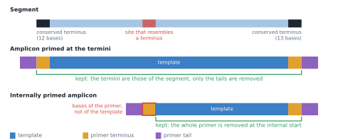

*Figure: A segment, an amplicon primed at its termini and an internally primed amplicon, with the part of each that is kept.*

Three facts shape the method:

- The primer bases of an internally primed read lie **at the end of the
  read**, exactly like those of any other read. Removing the primer by
  position removes the artefact without knowing where the read came
  from.
- The site stays covered by reads of full-length amplicons, which carry
  the true template there.
- A primer-like match **deep inside** a read is template, not the primer
  that started the amplicon. Cutting there destroys real sequence (this
  is what a generic trimmer without anchoring does).

## Conventions

The pseudocode follows Cormen et al.: indentation gives the block
structure; `=` assigns and `==` tests equality; `//` begins a comment;
sequences are indexed from 1 and `s[i:j]` is the subsequence from `i`
to `j`, both included (empty if `j < i`); `length(s)` is its length;
attributes are written `x.attr`; the words of a name are joined
with `_`, since `-` could be read as a subtraction: variables and
attributes in lower case (`too_few`), procedures and constants in
capitals (`ANALYSE_ENDS`, `NO_PRIMER`); `NIL` is "nothing"; `and` and `or`
short-circuit; parameters are passed by value, objects by reference.

Shared primitives:

| primitive | meaning |
| --- | --- |
| `RC(s)` | reverse complement of `s` |
| `EDIT(a, b)` | edit distance (substitution, insertion, deletion: 1 each); an IUPAC code equals any base it stands for, in either sequence |
| `FIND(p, s, k)` | the best alignment of the whole of `p` to a substring of `s` with at most `k` errors (ends of `s` free); returns a hit `hp` with `hp.start`, `hp.end`, `hp.errors`, or `NIL` |
| `FIND_ALL(p, s, k)` | all the matches of the whole of `p` in `s` with at most `k` errors, in one pass over `s`: one hit `hp` for each run of consecutive positions at which `p` ends with at most `k` errors, ending at the last position of the run with the fewest errors and starting as early as that number of errors allows |
| `INC(c)`, `INC(c, v)` | add 1, or `v`, to the counter `c` |
| `argmax(A)`, `argmin(A)` | the index at which the array `A` is largest, or smallest; `argmax over i of f(i)` likewise for an expression |
| `MAX_ERRORS(p, e)` | errors accepted in a match of `p`: `⌊e · length(p)⌋`, e.g. 2 of 12 bases at 20% (or `e` itself, if `e` is a number of errors) |

Objects:

- A **primer** `p` is a sequence whose 5′ part is a protocol *tail*
  (possibly empty) and whose 3′ part is the conserved *terminus* of the
  segment (12 or 13 bases). *Left* primers (Uni12 side) are stored as ordered; *right*
  primers (Uni13 side) are stored reverse-complemented, terminus first.
- A **primer hit** `hp` has `hp.start`, `hp.end` (read positions),
  `hp.errors`, and `hp.terminus_start`, `hp.terminus_end` (where the
  conserved terminus lies in the read, from the alignment path).
- A **reference hit** `hr` has `hr.ref`, `hr.pos`, `hr.strand`,
  `hr.errors`. `hr.pos` is the plus-strand position of the *first base of
  the probe*; for strand `−` the probe runs towards the start of the reference.
  `hr.ambiguous` is set if another reference matches the probe with as
  few errors.
- An **end** `x` of an analysis `a` (`a.left`, `a.right`) carries the
  primer hit found there (`x.start`, `x.end`, `x.errors`,
  `x.terminus_start`, `x.terminus_end`); `x == NIL` is written for an end
  without a primer. `x.hit` is the reference hit of its probe (`NIL` if
  not located), `x.origin` its origin, and `x.inner` a position found
  from inside the read (A13), which an end without a primer can have too.
- Global parameters, with their defaults: *e* (the most errors accepted
  in a primer match, as a share of the primer length: 20% or 30%, A2),
  *W* = 100 (window; Illumina preset 10), *P* = 32 (probe length),
  *T* = 60 (terminal window), *refs* (the references, or `NIL`).

Positions inside the program are 0-based; here they are 1-based, as in
the tags flucut writes.

Layout of a procedure:

- Lines that only name its inputs, and comments that describe the
  procedure as a whole, come first and are not numbered.
- Every step is numbered. A comment on a line of its own that introduces
  a step carries the number of that step, and the code under it has
  none. A short comment stands at the end of the line of its step.
- A line that continues the one above is indented further and not
  numbered.
- `(→ A4)` at the end of a comment: the procedure called in this step
  is defined in that section. The comment says what the call does. The
  main algorithms are in parts A to C, the secondary procedures they
  call in the appendix (part D).
- A short conditional step is written on one line: `x = 0 if c` does
  the assignment only when `c` holds, and `return 30% if c else 20%`
  chooses between two values. Longer ones use `if` and `else` blocks.
- A counter is updated with `INC`; `INC(c) if condition` updates it
  only when the condition holds.
- Simple initialisations share a line: `errors = 0; bases = 0`.

Symbols of the running-time and memory analyses, given after each
section (worst case; the typical case too when it is very different).
Each analysis repeats the symbols it uses:

| | total length | number | length of one |
| --- | --- | --- | --- |
| reads of a readset | *n* | *N* | *n*′ (a read, or a part of a split read) |
| references | *m* | *M* | *m*′ |

The plain letter is the total, which is what the bounds of a whole run
are written in; the prime marks one sequence, as in the bounds of the
steps applied to a single read. The other symbols:

| symbol | meaning |
| --- | --- |
| *W*, *P* | window at a read end (100), probe length (32) |
| *h* | number of 10-mer seed hits of a probe |
| *w* | machine word (64 bits) |

These symbols belong to the analyses only. The variables of the
pseudocode are separate: a local `n`, `m` or `M` there is whatever its
procedure assigns (often a length or a list of matches).

`FIND(p, s, k)`, `FIND_ALL(p, s, k)` and `EDIT` use the bit-parallel
algorithm of Myers (edlib; for `FIND_ALL` and the probes of A10, one
machine word per pattern of up to 64 bases): `FIND` and `FIND_ALL` take
*O*(⌈*length(p)*/*w*⌉ · *length(s)*) time and *O*(*length(p)* +
*length(s)*) memory, so a primer or a probe is searched in time linear
in the text. *W* and *P* are options of a run; they are kept in the
bounds to show where the time goes. The primer scheme is fixed: 2 or 3
primers, each of at most 23 bases, searched one after the other. Their
number and length are treated as constants.

---

# A. flucut

Part A is the method: how the reads of a run are trimmed, and what is
reported about them. A1 gives the whole run; the other sections are its
steps:

- two settings are measured on the reads before the trimming: the
  error % allowed in a primer (A2) and the reference of each segment
  (A3);
- a read that holds several amplicons is split (A4);
- the ends of each part are analysed (A5): the primers are searched at
  both ends (A6, A7) and inside the read (A8), the origin of each end
  is classified (A9) from a probe located in the references (A10), and
  the part to keep is computed (A11);
- where a primer is missing, an adapter is searched and removed (A12);
- with references, the reads and ends not yet located are located from
  inside the read (A13), and the junction of an internal deletion is
  searched (A14);
- three summaries of a sample are built: the internal priming sites
  (A15), the amplicon lengths (A16) and the coverage profiles by read
  origin (A17).

The decisions rest on two searches: that of a primer at a read end, by
alignment (A7), and that of a probe of 32 bases in the references,
through a k-mer index (A10). Counters, tie-breaks, outputs and the index
are in the appendix (part D).

## A1. Trimming of the reads of a run

Each sample is processed once, read by read. Before that, the k-mer
index of the references is built, through which a probe (a short piece
of a read) is located in them quickly (line 1), and the error % allowed
in a primer match is calibrated on the first reads (line 2). For each
sample, the reference closest to the reads is chosen for each segment
(line 5). Each read is then processed independently. It is split into
parts if it holds several amplicons (line 7). In each part the primers
of the two ends are searched, the origin of each end is classified and
the range of positions to keep is computed (line 8). If a primer is
missing, a sequencing adapter may still be there: it is removed and the
search repeated (line 9). With references, a read whose ends were not
located on a reference is located by probes from inside it (lines
11–12), and a read with far fewer bases than the distance between its
ends is searched for an internal deletion (lines 13–14). The trimmed
part is written if it is long enough (lines 15 and 17), everything is
counted (line 16), and at the end of the sample its tables and report
are written (line 18).

> **Source:** `src/flucut.c`, `src/core/worker.c`, `src/seq/trimmer.c`

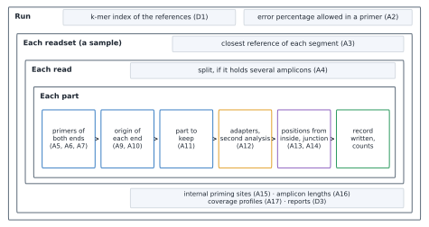

*Figure: The steps of a run, nested as its loops are, with the section that describes each.*

```
FLUCUT_RUN(inputs)
    // scheme, refs, index, e and allowed are global: the procedures called read them
    readsets = readset, one per input sample (file or directory)
    scheme = the left and right primers (option -s)
    refs = reference set (built-in, user-specified, or NIL)
 1  // k-mer index of the references: [k-mer → reference, position], k = 10 (→ D1)
    index = BUILD_INDEX(refs) if refs ≠ NIL
 2  // calibrate error allowance from primers in beginning of first readset: (→ A2)
    e = ALLOWED_ERROR_PERCENT(first readset in readsets)
 3  for each rs in readsets
 4      INIT_COUNTS(rs) // set all statistics of rs to zero (→ D2)
 5      // for each segment, the ref closest to its reads (→ A3)
        allowed = CLOSEST_REFERENCES(first file of rs)
 6      for each read r of rs
 7          for each part in SPLIT(r) // split read if contains multiple amplicons (→ A4)
 8              a = ANALYSE_ENDS(part, W, W) // computes: (→ A5)
                                             // - primers at both ends
                                             // - where each end started (terminal/internal)
                                             // - the position range to keep (a.from:a.to)
 9              // an end without a primer: remove its adapter, analyse again (→ A12)
                a = REMOVE_ADAPTERS(part, a) if N_PRIMERS(a) < 2 // adapter search can be turned off
10              if refs ≠ NIL
11                  // if no end located: place the read by a probe from inside it (→ A13)
                    a.placement = PLACE(part[a.from:a.to]) if a.left.hit == NIL and a.right.hit == NIL
12                  // if an end still has no position: locate it by probes further inside (→ A13)
                    LOCATE_ENDS_FROM_INSIDE(part, a) if a.left.hit == NIL or a.right.hit == NIL
13                  // d: reference bases between the positions of the two ends
                    d = |a.right.pos − a.left.pos| + 1
14                  // if the read has fewer bases than that, by over 100 and over 10%: a deletion (→ A14)
                    a.junction = FIND_JUNCTION(part, a) if d − length(part[a.from:a.to]) > max(100, ⌊ d / 10 ⌋)
15              // is enough left of the part to be written?
                keep = a.to − a.from + 1 ≥ max(1, minimum length)
16              UPDATE_COUNTS(rs, a, part, keep) // add a to the statistics of rs (→ D2)
17              // trimmed FASTQ record with tags (→ D3)
                WRITE_RECORD(rs.out, part, a) if keep
18      WRITE_REPORTS(rs) // tables and report from the statistics of rs (→ D3)
```

`x.pos` is the position of an end on the reference, from its probe or
from inside the read (A13). Steps 13 and 14 apply when both ends are
located on the same reference, on opposite strands. FIND_JUNCTION
checks that, and makes the comparison with the bases between the
primers: the kept part can hold up to 13 terminus bases more at each
end.

The index (D1) is built once per run, over the references of all
subtypes (when there are references, i.e. not with `-r off`).

A read is never reverse-complemented: all positions refer to the read as given.

### Inputs and readsets

`src/io/input-groups.c`. Each input is a FASTQ file (optionally gzipped),
an unaligned BAM, or a directory. A file is one readset; a directory is
one readset of its files; a directory with `barcode*` subdirectories (a
MinKNOW `fastq_pass`) gives one readset per barcode. A readset is one
sample and gets one output file. Nothing is pooled across readsets
except the throughput of the run. (The source code and the output files
call a readset a "group".)

### Platform presets

Option `-p`:

| | `nanopore` (default) | `illumina` |
|---|---|---|
| read model | whole amplicons with flanks | fragments; primer at the read start |
| window `-w` | 100 | 10 |
| Nanopore adapters | searched | not searched |
| probes not located by k-mers | aligned to every reference | left unlocated |

The narrow Illumina window matters: with a window of 100 bases, a
primer-like site within the first 100 bases of a short read would be
taken for the primer and the read cut there.

### References

`src/seq/references/reference.c`, `src/seq/references/builtin-references.c`. The references decide the
trimming mode; there is no separate option.

- Default: a built-in set of complete segments (with UTRs), downloaded
  once from NCBI (efetch) and cached under `$XDG_CACHE_HOME/flucut` or
  `~/.cache/flucut`. It holds four references of the HA of every
  subtype (H1 to H16), four of the NA of every subtype (N1 to N9) and
  the other six segments of isolates of several subtypes: the subtype
  of a sample is read from its HA and its NA, while the other segments
  differ little between subtypes (D7). The four references of a subtype
  are of different decades, hosts and places, as the lineages of one
  subtype can lie decades apart.
- The set named by the key `references` of the configuration file
  (`$XDG_CONFIG_HOME/flucut/config`, else `~/.config/flucut/config`),
  if there is one, instead of the built-in set: for instance a set
  built from the seed sequences of IRMA (D7). `src/user-config.c`.
- `-r <file>`: a FASTA file of the user.
- `-r off`: no references.

References must be **complete segments with the UTRs**. A read is
located by the sequence just after its primer, which in a full-length
read is UTR. Against coding sequences, terminal reads cannot be located
and only internally primed ones map: on SRR36760543, CDS references
located 10% of the reads, complete segments 86%. A warning is given when
the references start at a start codon and end at a stop codon
(`src/flucut.c`). The subtype of each reference is parsed from its FASTA
description (e.g. `(H5N1)`), and its segment from `segment <n>` or a
gene or protein name (`src/seq/primers/segments.c`).

### Threads, reproducibility, live mode

`src/core/worker.c`: `-j` workers each take a batch of 1000 reads in turn,
trim and compress it with their own objects, and write in input order.
Each batch is its own gzip member (libdeflate), so the output is
byte-identical for any number of threads.

`src/core/live.c`: `--live` follows a MinKNOW run. The input directories are
scanned every 10 s; a file is trimmed once it has not been modified for
`--min-age` (60 s) and is structurally complete; its reads are appended
to the output of the sample (gzip members concatenate) and all tables
and reports are rewritten. The HTML report becomes a self-reloading
dashboard with a tab per barcode. The run ends at the
`final_summary_*.txt` of MinKNOW, after `--timeout`, or on Ctrl-C;
`--resume` continues an interrupted run. Nothing differs in the method:
the outputs equal those of a normal run on the same files. The error
percentage (A2) is decided on the first file ready.

**Running time and memory.**

Symbols:
- *N* reads in the readset;
- *n* total bases of those reads;
- *n*′<sub>max</sub> length of the longest read;
- *M* number of references;
- *m* total length of the references.

| procedure | worst case | note | typical | note | memory | note |
| --- | --- | :-: | --- | :-: | --- | :-: |
| FLUCUT_RUN, in all | *O*(*Nm* + *n* · *n*′<sub>max</sub>) | ¹ | *O*(*n* + *m*) |  | *O*(*m*) | ² |
| &nbsp;&nbsp;&nbsp;– index | *O*(*m*) | ³ |  |  | *O*(*m*) | ³ |
| &nbsp;&nbsp;&nbsp;– reads | *O*(*n* + *Nm* + *n* · *n*′<sub>max</sub>) | ⁴ | *O*(*n*) | ⁵ | one batch per thread | ⁶ |
| &nbsp;&nbsp;&nbsp;– counts | *O*(*m* + *NM*) | ⁷ | *O*(*m* + *N*) |  | *O*(*m*) | ⁸ |
| INIT_COUNTS (D2) | *Θ*(*m*) per readset |  |  |  | *Θ*(*m*) | ⁸ |
| UPDATE_COUNTS (D2) | *O*(*M*) | ⁹ | *O*(1) |  | *O*(1) |  |

- ¹ The sum of the three phases. The terms *m* (index) and *n* (primer
  searches) are absorbed by the two others.
- ² Plus one batch of reads per thread; it does not depend on *N*.
- ³ Plus a table of 4^k entries, one per possible k-mer, but k is fixed to 10, i.e. ≈ 10^6 entries.
- ⁴ The sum of SPLIT and of the analysis of each part (lines 8–14) over
  the reads, each in its worst case. One part of length *n*′ takes
  *O*(*m* + *n*′²), typically *O*(*n*′):
  - *n*: the primer searches, which read every base;
  - *Nm*: every read has a probe without a seed, which is aligned to
    all references (A10);
  - *n* · *n*′<sub>max</sub>: every read has a deletion whose junction no
    probe brackets, so that its whole template is aligned, in *n*′² per
    read (A14).
- ⁵ Probes are located through their seeds, and junctions bracketed by
  the bisection: what remains is linear in the bases read.
- ⁶ 1000 reads per batch.
- ⁷ INIT_COUNTS once, then UPDATE_COUNTS for each part of a read (D2).
- ⁸ Arrays over the reference positions: 2 for the sites, 2 for each of
  the 7 coverage categories.
- ⁹ When COVER falls back on the reference lengths (A17).

## A2. Calibration of the error percentage allowed in primers

The number of errors accepted in a primer match has to fit the error
rate of the reads: with too few, primers are missed; with too many,
template is taken for a primer. In the first 1000 reads (line 2) the
primers are searched with a provisional limit of 20% (line 3), and the
error rate of their alignments is computed, as errors per aligned base
(lines 4–7). If the rate is 4% or more 30% is allowed, otherwise 20%
(line 8).

> **Source:** `src/core/auto-settings.c`

```
ALLOWED_ERROR_PERCENT(file)
   // ANALYSE_ENDS runs here with e = 20% (a provisional limit) and without references
1  errors = 0; bases = 0
2  for each read r in first 1000 reads of file
3      a = ANALYSE_ENDS(r, W, W) // find the primers of both ends (→ A5)
4      // x: the primer found at the left, then at the right end of r (NIL: none found)
       for each x in ⟨a.left, a.right⟩ with x ≠ NIL
5          INC(errors, x.errors) // errors of the primer alignment
6          INC(bases, x.end − x.start + 1) // count bases in primer
7  rate = 0 if bases == 0 else errors / bases
8  return 30% if rate ≥ 4% else 20%
```

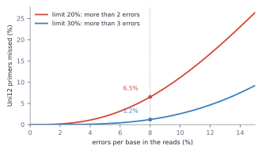

*Figure: The share of Uni12 primers (12 bases) with more errors than each limit allows, by the error rate of the reads (binomial model). At 8% errors per base, 6.5% of the primers have more than 2 errors and 1.2% more than 3.*

Errors accepted in a match of each primer (the percentage of its
length, rounded down):

| primer | length | at 20% | at 30% |
| --- | :-: | :-: | :-: |
| `uni12`, `uni12r` | 12 | 2 | 3 |
| `uni13` | 13 | 2 | 3 |
| `mbtuni-12`, `mbtuni-12.4r` | 22 | 4 | 6 |
| `mbtuni-13` | 23 | 4 | 6 |

Why a measured 4% leads to a limit of 30%: the rate is an average over
many bases, the limit a ceiling for one short primer.

- A primer of 12 bases often carries 2 or 3 errors when the average is
  a few percent. At 8% errors per base, 6.5% of the Uni12 primers have
  more than 2 errors and would be missed with 20%; 1.2% have more than 3
  (binomial model).
- The measured rate understates the true one: primers beyond the
  provisional 20% are not found, so not counted. Simulated reads with
  4, 8 and 12% errors measure 3.0, 5.0 and 6.3%.
- 30% is not used always, because a wider limit also takes more of the
  virus for a primer: in the benchmark it removed about 3 times more
  template than 20%.

The three values (20%, 30%, 4%) are calibrated on simulated reads.

On the command line the limit is written `-e 20%` (or as a fraction,
`-e 0.2`); a whole number is a number of errors instead (`-e 3`); `auto`
(the default) is the calibration above.

Calibration: on reads simulated at 1, 2, 4, 8 and 12% errors (measured
0.9, 1.7, 3.0, 5.0 and 6.3%), 20% left few primer bases up to 4%; at 8
and 12%, 30% left 4 times fewer primer bases and 2–4 times fewer bases
of the internal site, at the cost of about 3 times more template
removed.

**Running time and memory.**

Symbols:

- *n*′ length of the read (or part).

| procedure | time | note | memory |
| --- | --- | :-: | --- |
| ALLOWED_ERROR_PERCENT | *O*(*n*′) | ¹ | *O*(*n*′) |

- ¹ The bound of ANALYSE_ENDS (A5) without references, which is called
  1000 times: once for each of the first 1000 reads.

## A3. Choice of the closest reference of each segment

The reference of a segment is chosen by counting, over probes taken from
the reads, which reference each probe matches best. From each of the
first 2000 reads, eight probes of 32 bases, evenly spaced along the
read, are located in the references by their 10-mer seeds (lines 9–13).
A located probe is one vote for its reference; an ambiguous probe,
which a reference of another segment or subtype matches with as few
errors, is not counted (line 14). References of one segment and subtype
which match it equally well do not make it ambiguous: the probe says
which subtype it belongs to, and the match kept stands for all of them.
The subtype of a segment is decided before the reference, by the votes
of all its references of each subtype together (line 17): a subtype
whose lineages share its votes would otherwise lose to a single
reference of another subtype with fewer votes than they have between
them. A segment is clear if its leading subtype has at least 20 votes
and 60% of the votes of the segment (line 19), and the reference chosen
in it is the one with most votes of that subtype (lines 18 and 26). A
segment that is not clear follows the subtype chosen by most clear
segments (lines 21–22), if one of its plausible references has that
subtype (lines 27–31); the HA and the NA never follow, as they make the
subtype (line 29). Otherwise it takes the reference of its leading
subtype (lines 32–33) or, with too few votes, keeps all its references
(line 34). If a segment has too few votes, the count is
extended once, to up to 20,000 reads (lines 7–8).

> **Source:** `src/core/auto-settings.c`

When a segment has several references (e.g. one per subtype, as in the
built-in set), a readset is classified against one of them only: the
one closest to its reads. Each segment is chosen by its own reads, since
a reassortant is closest to references of different subtypes in
different segments; a segment other than HA and NA whose reads do not
single out a reference follows the segments that are clear.

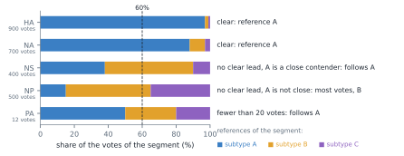

*Figure: An example of the choice: the shares of the votes of five segments, and the reference each one takes. Reference A is that of the subtype chosen in most clear segments.*

```
CLOSEST_REFERENCES(file)
    // find for each segment, the closest reference to its reads
    // refs[s]: references of segment s in refs; R.subtype: the subtype of a reference R
    // P: the probe length (32)
 1  undecided_segments = {s : length(refs[s]) > 1} // segments with multiple references
 2  allowed = refs // of each undecided segment, only the closest will be left
 3  if undecided_segments ≠ ∅
 4      votes = [0, 0, 0, ...] // for each R in refs
 5      n = 0 // reads used
 6      too_few = 1 // segments with too few votes (init to 1 so first stage runs)
 7      for each limit in ⟨2000, 20000⟩
 8          if too_few > 0 and n < n_reads(file)
 9              while n < min(limit, n_reads(file))
10                  INC(n); r = nth read in file
11                  for j = 1 to 8 // probes evenly spaced along the read
12                      o = ⌊ (length(r) − P) · (2j − 1) / 16 ⌋
13                      hr = LOCATE_SEEDED(r[o + 1:o + P]) // finds where probe lies in ref (→ A10)
                        // hr.ambiguous = another reference matches as well
14                      INC(votes[hr.ref]) if hr ≠ NIL and not hr.ambiguous
15              // the subtype of a segment: the votes of its references counted together
                clear = ∅
16              for each segment s in undecided_segments
17                  lead[s] = argmax(subtype X of refs[s], sum(votes[R] : R.subtype == X))
18                  pick[s] = argmax(votes[R] : R in refs[s], R.subtype == lead[s])
                    best[s] = argmax(votes[refs[s]]) // the leading reference, at a tie: the first
                    lead_votes = sum(votes[R] : R in refs[s], R.subtype == lead[s])
                    total = sum(votes[refs[s]])
                    // with references without a subtype: pick[s] = best[s], lead_votes = votes[best[s]]
19                  clear = clear ∪ {s} if lead_votes ≥ 20 and lead_votes ≥ 0.6 · total
20              // common: the subtype chosen in most clear segments (NIL if none is clear)
                n_clear = [0, 0, 0, ...] // for each subtype
21              INC(n_clear[lead[s]]) for each s in clear
22              common = argmax(n_clear) if clear ≠ ∅ else NIL // at a tie: most votes
23              too_few = 0
24              for each segment s in undecided_segments
25                  if s in clear
26                      allowed[s] = {pick[s]}
27                  // possible choices of s: the close contenders; all, with too few votes
                    else possible = {R in refs[s] : votes[R] ≥ 0.5 · votes[best[s]]}
28                      possible = refs[s] if lead_votes < 20
29                      // the HA and the NA make the subtype: they never follow
                    follow = the R in possible with R.subtype == common // NIL if none, or s is HA or NA
30                      if follow ≠ NIL
31                          allowed[s] = {follow} // as the clear segments
32                      elseif lead_votes ≥ 20
33                          allowed[s] = {pick[s]} // no clear lead: the leading subtype
34                      else INC(too_few) // s keeps all its references
35  return allowed
```

A read shorter than *P* gives no probe; a read so short that two of its
8 probes start at the same position gives that probe once.

A segment that is not clear follows the clear ones where it can, except
the HA and the NA. These two make the subtype, and the other segments
do not tell it: the internal genes of a reassortant are often closest
to references of another subtype (e.g. an H5N1 with internal genes of
low pathogenic viruses). They are chosen by their own reads only: the
reference with most votes, or all their references if the votes are too
few. For the other segments, with too few votes any of their references
is possible, so the one of the common subtype is taken. Without a clear lead it takes the one of the
common subtype only if that reference is a close contender (at least
half the votes of the leading one); otherwise the reference with most
votes is used: more reads would not change the shares, and keeping
all references of such a segment makes a run 45–60% slower (measured
on two samples in which four segments had no clear lead) and scatters
the reads over references. References without a known subtype (a
user's FASTA without it in the description) do not follow.

How the matching is done. No primer is searched here: each probe is 32
bases of the read, located through its 10-mers and aligned around them
with at most 20% errors (A10). A probe counts for the reference in which
it has the fewest errors.

Shared sequence. The references of a segment are homologous, and the
internal genes of different subtypes can be nearly identical over long
stretches. A probe from such a stretch matches several references with
the same number of errors: it tells nothing, and does not vote (it
would otherwise go to the first reference tried). Only probes from
stretches where the references differ decide.

How often. In the first 20,000 reads of two H5N1 samples, against the
a set of five subtypes of every segment, 27–66% of the located probes of each
segment other than HA matched several references (over half in PB2, PB1
and NP), and under 0.1% of those of HA. HA, NA and M were clear for
H5N1 in both samples, PB1 for H7N9, and NS for H7N9 in one: the common
subtype is H5N1. In the other sample NS (59% of its votes for H7N9) and
PB2 had no clear lead and H5N1 as a close contender, and follow H5N1;
PB2 in the first sample, and PA and NP in both, had no clear lead and
no close H5N1 reference, and keep the reference with most votes.

Why one reference per segment: UTRs are conserved across subtypes, so a
terminal read matches the segment of any subtype, while coding regions
diverge, so that a noisy read start finds spurious interior matches in
the wrong reference. One reference per segment avoids scattering the
reads and inflating internal priming. The log (`-v`) says how each
reference was chosen.

`--segment <s>` similarly restricts the classification to one segment,
for runs of one segment alone. On whole-genome reads it must not be
used: ends of the other segments would not be located and would lose
their termini.

**Running time and memory.**

Symbols:

- *P* probe length (32);
- *M* number of references;
- *m* total length of the references;
- *h* 10-mer seed hits of a probe.

| procedure | worst case | note | typical | note | memory | note |
| --- | --- | :-: | --- | :-: | --- | :-: |
| CLOSEST_REFERENCES | *O*(*h* log *h* + *m*) | ¹ | *O*(*P*) | ² | *O*(*M* + *h*) | ³ |

- ¹ The bound of LOCATE_SEEDED (A10), which is called for 8 probes of
  each read used: 2000 reads, or up to 20,000.
- ² Per probe: it is found through its seeds.
- ³ One vote counter per reference, and the seed hits of one probe.

The decision (lines 15–34) takes *O*(*M*) time, once per stage.

### Reads of a second HA or NA subtype

> **Source:** `src/analysis/subtype-reads.c`; called from `src/core/auto-settings.c`

The votes of a segment can be split between two references for two
reasons, which the votes alone do not separate: one virus lying between
the two references, whose reads each vote for both, or reads of two
viruses, each voting for one. The probes of one read tell them apart,
because in the second case they agree with each other. flucut uses
this in the HA and in the NA, whose references name a subtype of their
own, while the probes of CLOSEST_REFERENCES are located: no read is
read again.

The references of one subtype are taken together: `R.number` is the H
number of a reference of the HA and the N number of one of the NA
(H5 for the HA of an H5N1 and of an H5N8 reference alike). For each of
the two genes, a read with at least two voting probes in it is counted
by its number of voting probes *k* (line 6), and as a read of a subtype
if all of them vote for that subtype (line 7). The subtype with most
votes is the leading one (line 9). If each probe voted independently of
its read, a read with *k* voting probes would be all for a subtype with
the share *p* of the votes with probability *p*^k: this gives the
reads of each other subtype expected by chance (line 12), and the
observed ones beyond them are its excess (line 13). The second subtype
is the one with the largest excess (line 14).

```
SECOND_SUBTYPE(g)
    // the reads of a second subtype in the gene g (HA or NA)
    // votes_of(r): the references the voting probes of the read r voted for
    //   in g (lines 11–14 of CLOSEST_REFERENCES), at most 16
 1  votes = [0, 0, ...]; agreeing = [0, 0, ...] // for each subtype number
 2  reads = [0, 0, ...] // for each number of voting probes
 3  for each read r used by CLOSEST_REFERENCES
 4      V = ⟨R.number : R in votes_of(r), R.number ≠ NIL⟩
 5      INC(votes[x]) for each x in V
 6      INC(reads[length(V)]) if length(V) ≥ 2
 7      INC(agreeing[V[1]]) if length(V) ≥ 2 and all of V are equal
 8  n = sum(reads); total = sum(votes)
 9  leading = argmax(votes)
10  second = NIL; excess = 0
11  for each subtype x ≠ leading with agreeing[x] > 0
12      expected = sum over k of reads[k] · (votes[x] / total)^k
13      if second == NIL or agreeing[x] − expected > excess
14          second = x; excess = agreeing[x] − expected
15  above = second ≠ NIL and excess ≥ 2.5 and excess ≥ 0.01 · n
16  return leading, second, n, agreeing[leading], agreeing[second], excess, above
```

The report gives the numbers of line 16 for the HA and the NA of each
sample, and makes a remark when `above` holds. The remark states the
observation (e.g. "reads of a second HA subtype (H9): 14 of 56, 25.0%")
and its possible causes: a mixed infection, a contamination of the
sample, or barcode crosstalk between the samples of a run. The reads do
not say which, and flucut does not either.

The two thresholds of line 15. The excess must be at least 2.5 reads,
that is 3 reads where none is expected: simulated samples with one
subtype in the gene had at most 1 read of another subtype among the
about 240 counted in 2000 reads, and in two sequenced runs which held
samples of several subtypes 1 or 2 reads of the subtype of another
sample were common (0.4 to 0.7% of the reads counted), as barcode
crosstalk gives. It must also be at least 1% of the reads counted: when
20,000 reads are counted instead of 2000, the number of reads alone no
longer separates the cases (simulated samples of one subtype then had
up to 7 reads of another one among about 2700, with an excess of up to
2.4), and the background of a sequenced run alone would give more than
3. With both, the rule means the same at either depth.

What was measured (`benchmark/RESULTS.md`, 2026-11-28), on simulated
reads of 17 genomes outside the built-in set and of mixes of two of
them, at mean error rates of 4, 8 and 12%, in four series (800, 3200
and 32,000 reads, and 32,000 reads with a scarce NA, of which 20,000
are counted). No sample with one subtype in the gene was above the
thresholds: 0 of 528 for the HA and 0 of 648 for the NA. Runs above
them with the right second subtype, by minor fraction (48 runs for the
HA and 42 for the NA in each cell):

| series | gene | 50% | 10% | 5% | 2% | 1% |
|---|---|---|---|---|---|---|
| 800 reads | HA | 48 | 48 | 44 | 0 | 0 |
| | NA | 42 | 42 | 38 | 0 | 0 |
| 3200 reads | HA | 48 | 48 | 48 | 40 | 18 |
| | NA | 42 | 42 | 42 | 35 | 12 |
| 32,000 reads | HA | 48 | 48 | 48 | 35 | 14 |
| | NA | 42 | 42 | 42 | 30 | 10 |
| 32,000 reads, scarce NA | HA | 48 | 48 | 48 | 48 | 9 |
| | NA | 41 | 20 | 0 | 0 | 0 |

A sample of 3200 and one of 32,000 reads give the same, as the first
2000 reads are counted in both; a minor strain at 1% has two or three
reads of the HA among them, fewer than the 3 required in most samples.
With 20,000 reads counted, 2% is always seen and 1% rarely, as it lies
at the share threshold. In 104 sequenced samples (37 Nanopore runs, the
first file of each), 10 were above the thresholds and 48 had at least
one read of a second subtype.

Limits. Two viruses of the same subtype are not told apart. The other
six segments are not looked at: with the per-reference form of the
statistic, their excess in samples of one strain is as large as in
mixes (`benchmark/RESULTS.md`). The reads are those the references are
chosen from, the first 2000 of the first file of a sample (20,000 if a
segment has too few votes), so the smallest fraction seen depends on
how many reads of the HA and of the NA that file begins with. The
probes of a short read overlap, and those of a read from a stretch
where its virus is closer to another subtype vote alike: the
independence of line 12 is a null model, not a property of the reads.
The counts of several samples together (a whole run) are not judged, as
the subtypes of its samples may differ.

SECOND_SUBTYPE adds *O*(1) time per probe and *O*(1) memory: one counter
per subtype number and per number of probes.

## A4. Splitting of a read that holds several amplicons

A read can hold two or more amplicons joined end to end. Primers then
lie inside the read, not only at its ends. The conserved 12 or 13 bases
of the primers are searched everywhere in the read, with at most 2
errors (TERMINUS_MATCHES; SPLIT line 2). A junction is recognized in two
cases. The first is a pair: the end of one amplicon followed within 100
bases by the start of another, with at most 2 errors in the two matches
together and at least 32 bases outside the pair on each side, enough for
an amplicon to be there (SPLIT line 7). The read is cut there and the
bases between the two are dropped (lines 14–16), unless the references
show that the read simply continues across the pair: the two matches are
then template that resembles the primers (lines 9–13). The second is a
lone match away from the read ends, used only with references (lines
18–26): it is a junction if the read stops following the reference
there. STOPS_HERE checks that the probe on the amplicon side of the
match is located in a reference (lines 1–7), that the bases on the other
side do not continue that reference across the match (lines 8–9) and
that the probes on the other side, at three distances, are not
continuous with the probe on that reference (lines 10–19). The cut is
placed outside the whole primer, tail included (PRIMER_BOUND). The
segments contain primer-like stretches, so each rule is designed to
avoid splitting a read that holds a single amplicon.

The alignment of lines 8–9 is what keeps a complete amplicon of a sample
far from every reference whole. A probe of such a read is often not
located at all, and a location that is missing is no evidence that the
read stops: aligned to the reference where the amplicon side lies, the
bases of the sample still fit it, while the bases of another amplicon do
not.

> **Source:** `src/seq/search/terminus-matches.c`, `src/seq/reads/chimera.c`

The patterns searched are the conserved terminus of each primer of the
scheme and its reverse complement. On the strand of the read each is
either the START of an amplicon (a left terminus; the reverse
complement of a right terminus as stored) or the END of one (the other
two forms).

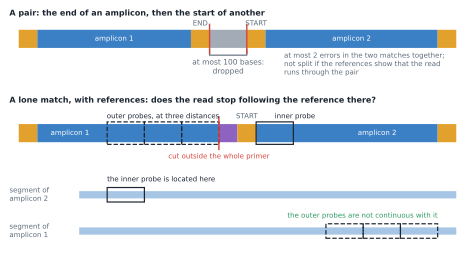

*Figure: The two kinds of junction: a pair of matches, and a lone match at which the read stops following the reference.*

```
SPLIT(read)
 1  n = length(read)
 2  M = TERMINUS_MATCHES(read)
 3  parts = ⟨⟩; begin = 1; i = 1
 4  while i ≤ length(M) and length(parts) < 7 // at most 8 parts
 5      m = M[i]
 6      next = M[i + 1] if i < length(M) else NIL
 7      // a pair: the end of an amplicon, then within 100 bases the start of
        // another, with at most 2 errors in the two matches together
        // and an amplicon on each side of it
        if next ≠ NIL and m.kind == END and next.kind == START
                and next.start − m.end − 1 ≤ 100 and m.errors + next.errors ≤ 2
                and m.start > 32 and n − next.end ≥ 32
 8          runs_through = FALSE
 9          if refs ≠ NIL
10              // the read runs through the pair if the bases before it and
                // those after it are next to each other in a reference
                a = max(1, m.start − P); b = next.end + 1
11              x = LOCATE(read[a:m.start − 1]) // locate the probe in the references (→ A10)
12              y = LOCATE(read[b:b + P − 1])
13              runs_through = CONTINUOUS(x, y, b − a, 30)
14          if not runs_through
15              // an amplicon ends, the next begins: the gap is dropped
                append (begin, m.end) to parts
16              begin = next.start
17          INC(i) // next is not looked at again
18      elseif refs ≠ NIL
19          if m.kind == START and m.start > W + 1 and STOPS_HERE(read, m)
20              b = PRIMER_BOUND(read, m) // the tail goes with its primer
21              append (begin, b − 1) to parts
22              begin = b
23          elseif m.kind == END and m.end < n − W and STOPS_HERE(read, m)
24              b = PRIMER_BOUND(read, m)
25              append (begin, b) to parts
26              begin = b + 1
27      INC(i)
28  append (begin, n) to parts
29  return parts without its empty intervals
```

```
TERMINUS_MATCHES(read)
   // every match of a terminus, at most 2 errors; of overlapping ones the best
1  C = ∅
2  for each pattern t, in order
3      for each hp in FIND_ALL(t, read, min(MAX_ERRORS(t, e), 2))
4          C = C ∪ {hp, with hp.kind = t.kind and hp.pattern = t}
5  M = ⟨⟩
6  for each c in C, by errors, then order of the pattern, then start
7      append c to M if c overlaps no match of M and length(M) < 16
8  return M sorted by start
```

```
STOPS_HERE(read, m)
 1  // the amplicon side of m must hold a whole probe, found in the references ...
    if m.kind == START
 2      return FALSE if m.end + P > length(read)
 3      // locate the probe in the references (→ A10)
        inner = LOCATE(read[m.end + 1:m.end + P])
 4  else
 5      return FALSE if m.start ≤ P
 6      inner = LOCATE(read[m.start − P:m.start − 1])
 7  return FALSE if inner == NIL
 8  // ... and the bases on the other side, the match included, must not
    // continue the reference of the probe from where the probe lies ...
    return FALSE if CONTINUES_REFERENCE(read, m, inner)
 9  // ... nor must a probe of that side be continuous with it; three are tried
    for i = 0 to 2
10      if m.kind == START
11          a = max(1, m.start − (i + 1) · P)
12          outer = LOCATE(read[a:a + P − 1])
13          return FALSE if CONTINUOUS(outer, inner, m.end + 1 − a, 10 · (i + 1))
14      else
15          a = max(1, m.start − P) // first base of the inner probe
16          b = m.end + 1 + i · P
17          outer = LOCATE(read[b:b + P − 1])
18          return FALSE if CONTINUOUS(inner, outer, b − a, 10 · (i + 1))
19  return TRUE
```

```
CONTINUES_REFERENCE(read, m, inner)
   // the bases on the other side of m, 3P of them and those of m itself,
   // aligned to the reference of the probe inner, from where inner lies outwards
 1  if m.kind == START
 2      b = m.end; a = max(1, b − 3P − (m.end − m.start + 1))
 3      anchor = inner.pos − 1 if inner.strand == "+" else inner.pos + 1
 4  else
 5      a = m.start; b = min(length(read), a + 3P + (m.end − m.start + 1))
 6      anchor = inner.pos + P if inner.strand == "+" else inner.pos − P
 7  x = read[a:b], reverse-complemented if inner.strand == "−"
 8  return FALSE if length(x) < 16 // too few bases to tell
 9  return FLANK_DIFFERENCES(x, inner.ref, anchor) ≤ 40% · length(x) // → A13
```

```
CONTINUOUS(x, y, in_read, tolerance)
   // two located probes, x before y in the read, their first bases in_read apart
1  if x == NIL or y == NIL or x.ref ≠ y.ref or x.strand ≠ y.strand
2      return FALSE
3  in_ref = y.pos − x.pos if x.strand == "+" else x.pos − y.pos
4  return in_ref − in_read ≥ −tolerance
```

```
PRIMER_BOUND(read, m)
    // where the primer of m begins (START) or ends (END): its tail lies outside m
    // tailed(m): the whole primers, as on the strand of the read, with terminus m.pattern
 1  b = m.start if m.kind == START else m.end
 2  for each primer o in tailed(m)
 3      k = MAX_ERRORS(o, e)
 4      reach = length(o) − length(m.pattern) + k
 5      if m.kind == START
 6          hp = FIND(o, read[m.start − reach:m.end], k)
 7          b = min(b, hp.start) if hp ≠ NIL
 8      else
 9          hp = FIND(o, read[m.start:m.end + reach], k)
10          b = max(b, hp.end) if hp ≠ NIL
11  return b
```

Probes and search windows are clipped to the read; a probe shorter than
16 bases is not located. The last line of CONTINUOUS accepts any
*longer* distance on the reference: a read with an internal deletion is
one template, and is not split at a junction that resembles a primer.

The limits on the errors are heuristics against chance matches, chosen,
not calibrated:

- a terminus has 12 or 13 bases. With 3 errors allowed a read of 2 kb
  holds about ten matches by chance, so a terminus is allowed at most 2
  whatever *e* is;
- two matches by chance next to each other are still common at 2 errors
  each (about 1 read in 100 of 2 kb), so the two matches of a pair may
  have 2 errors together. On 200 error-free random amplicons of 2 kb
  and 24 error-free influenza amplicons, no read is then split, at
  *e* = 20% and 30%;
- an END match just after the primer that starts the read has only that
  primer and a few bases before it, which every segment start matches:
  the amplicon side must hold a whole probe;
- the share of bases that may differ from the reference for a read to be
  taken as running through a match is 40%. It separates the two kinds of
  bases widely: on simulated reads of 4 to 12% errors (C1), against
  the built-in references, which are far from the simulated genome, any
  value from 40% to 60% gives the same reads, splitting none of the
  complete amplicons and 167 of the 173 reads that hold two amplicons.

The splitting is done first, so that every primer ends up at an end of
a part. A match of a terminus is not by itself a junction, because a
full-length read runs through the primer-like sites of its own segment.
Each part is then treated as a read; its record is named `<read>_<k>`
with the tag `sp:Z:k/n`. `--no-split` disables the splitting.

Why it matters: in a sample with few complete HA amplicons, the primers
of internally primed amplicons buried inside joined reads can be enough
on their own to produce `AAA` in the consensus.

**Running time and memory.**

Symbols:
- *n*′ length of the read (or part);
- *P* probe length (32);
- *m* total length of the references;
- *h* 10-mer seed hits of a probe.

At most 8 patterns are searched: the terminus of each primer and its
reverse complement.

| procedure | worst case | note | typical | note | memory |
| --- | --- | :-: | --- | :-: | --- |
| TERMINUS_MATCHES | *O*(*n*′) | ¹ | *O*(*n*′) |  | *O*(1) |
| CONTINUOUS | *O*(1) |  |  |  | *O*(1) |
| STOPS_HERE | *O*(*m*) | ² | *O*(*P*) |  | *O*(*h*) |
| PRIMER_BOUND | *O*(1) | ³ |  |  | *O*(1) |
| SPLIT | *O*(*n*′ + *m*) | ⁴ | *O*(*n*′) | ⁵ | *O*(*n*′) |

- ¹ One pass over the read per pattern, whatever the number of matches;
  at most 32 matches per pattern are kept.
- ² Four LOCATE: the inner probe once, three outer probes.
- ³ A window of the length of a primer plus its errors.
- ⁴ Constants up to 8 (passes) and 16 · 4 (LOCATE): two for a pair, four
  for a lone match.
- ⁵ Most matches lie in the window of a read end and are not tested.

## A5. Analysis of the ends of a read

A read can come from either strand, so it is not known in advance which
primer is at which end. The left primer is searched at the start of the
read and the right primer at its end (line 1). Unless both are found
without errors, the same is done on the reverse complement of the read
(lines 2–4), and the orientation with more primers, then with fewer
errors, is kept (lines 5–12). In that orientation the primer matches
inside the read are collected (line 13), the probe of each end is
located in the references and its origin classified, terminal (at a
segment terminus) or internal (line 14), and the part of the read to
keep is computed (lines 15–17). The result is given in the positions of
the read as it was (lines 18–19).

> **Source:** `analyze` in `src/seq/reads/amplicon.c`

> **Called from:** FLUCUT_RUN (A1), ALLOWED_ERROR_PERCENT (A2) and
> REMOVE_ADAPTERS (A12)

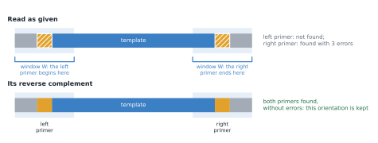

*Figure: The primers are searched in the windows of the two ends, in the read as given and in its reverse complement; the orientation with more primers, then with fewer errors, is kept.*

```
ANALYSE_ENDS(seq, w_start, w_end)
 1  // search the primers of the two ends in one orientation (→ A6)
    plus = LAYOUT(seq, w_start, w_end)
 2  minus = NIL
 3  if N_PRIMERS(plus) < 2 or TOTAL_ERRORS(plus) > 0
 4      minus = LAYOUT(RC(seq), w_end, w_start)
 5  // MINUS_IS_BETTER: more primers, then fewer errors; at a tie, plus (→ D4)
    if minus ≠ NIL and N_PRIMERS(minus) > 0 and MINUS_IS_BETTER(minus, plus)
 6      a = minus
 7      s = RC(seq)
 8      a.strand = "−"
 9  else a = plus
10      s = seq
11      a.strand = "+"
12  a.strand = "." if N_PRIMERS(a) == 0
13  // collect primer matches between the two end primers (→ A8)
    a.internal = MATCHES_INSIDE(s, a)
14  // locate the probe of each end and set its origin (→ A9)
    CLASSIFY_ENDS(s, a) if refs ≠ NIL
15  (a.from, a.to) = KEEP(a, length(s)) // compute the part of the read to keep (→ A11)
16  if minus ≠ NIL and a.from ≤ a.to
17      // remove a primer of the same end found at the other read end (→ A11)
        CUT_FACING_PRIMER(a, the layout not chosen, length(s))
18  if a.strand == "−"
19      mirror a.from, a.to and a.internal back to the positions of seq
20  return a
```

`N_PRIMERS(a)` is the number of ends of `a` with a primer (0, 1 or 2);
`TOTAL_ERRORS(a)` the sum of the errors of those primers.

Both orientations are compared because the tailed primers of the two
ends share their tail, so that a primer of one end can match, with
errors, at the other end of a read of the opposite strand.

**Running time and memory.**

Symbols:
- *n*′ length of the read (or part);
- *W* window at a read end (100);
- *P* probe length (32);
- *m*′ length of one reference;
- *m* total length of the references.

| procedure | worst case | note | typical | note | memory | note |
| --- | --- | :-: | --- | :-: | --- | :-: |
| ANALYSE_ENDS | *O*(*n*′ + *m*) | ¹ | *O*(*n*′) | ² | *O*(*n*′) | ³ |
| MINUS_IS_BETTER (D4) | *O*(1) |  |  |  | *O*(1) |  |

- ¹ In full *O*(*n*′ + *W* + *m*): reverse complement and MATCHES_INSIDE
  (*n*′), LAYOUT twice (*W*), two LOCATE (*m*).
- ² The probes are located through their seeds, in *O*(*P*).
- ³ Plus *O*(*W*) for the alignment table of A7.

## A6. Search of the primers of both ends

LAYOUT looks for the left primer in the first *W* bases of the read and
for the right primer in the last *W*, with room for the primer itself
(lines 2 and 6). A primer further inside than the window is not accepted
(lines 3 and 7), and the right primer is searched after the left one, so
that the two belong to the same amplicon (lines 4–5). When the scheme
has several primers for an end, BEST_PRIMER tries each (lines 2–3) and
keeps the one nearest the read end, then the one with fewer errors, then
the longer (line 4).

> **Source:** `search_layout`, `search_end`, `better_hit` in
> `src/seq/reads/amplicon.c`

```
LAYOUT(seq, w_left, w_right)
   λ = length of the longest primer of the scheme
1  n = length(seq)
2  a.left = BEST_PRIMER(left primers, seq[1:min(n, w_left + λ)], LEFT)
3  // must begin within the window
   a.left = NIL if a.left ≠ NIL and a.left.start > w_left + 1
4  // the right primer is searched after the left one: same amplicon
   after = a.left.end + 1 if a.left ≠ NIL else 1
5  lo = max(after, n − w_right − λ + 1)
6  a.right = BEST_PRIMER(right primers, seq[lo:n], RIGHT)
7  // must end within the window
   a.right = NIL if a.right ≠ NIL and a.right.end < n − w_right
8  return a
```

```
BEST_PRIMER(primers, s, side)
1  best = NIL
2  for each primer p of primers, in the order of the scheme
3      // align the primer to the read end, outer bases possibly missing (→ A7)
       hp = PRIMER_AT_END(p, s) at the end side of s
4      // BETTER: the outermost, then fewer errors, then the longer (→ D4)
       if hp ≠ NIL and (best == NIL or BETTER(hp, best, side))
5          best = hp
6  return best
```

The outermost candidate wins because the primer that started the
amplicon is the one nearest the read end; anything primer-like further
in is template.

The default window of 100 bases leaves room for the native barcoding
adapter (46 bases) and more.

**Running time and memory.**

Symbols:

- *W* window at a read end (100).

| procedure | time | note | memory |
| --- | --- | :-: | --- |
| BETTER (D4) | *O*(1) |  | *O*(1) |
| BEST_PRIMER | *O*(*W*) | ¹ | *O*(*W*) |
| LAYOUT | *O*(*W*) | ² | *O*(*W*) |

- ¹ One alignment table (A7) for each primer of that end.
- ² Constant in the length of the read.

## A7. Alignment of a primer to a read end

A primer at a read end is often incomplete or altered: it can have
sequencing errors, be truncated (lack its outer bases), or the read can
begin in the middle of it. ALIGN_END aligns the primer to the read end
by dynamic programming, with the edit distance as cost: substitutions,
insertions and deletions (lines 6–10). The match may begin anywhere in
the read at no cost (line 5), and part-way into the primer at a cost
(the arrays `edge` in line 7 and `skip` in line 10). The match with the
lowest cost is taken if it is within the errors allowed (lines 11–12),
and extended inwards where that costs nothing (lines 13–14).
MISSING_COSTS computes these costs: a truncated primer must retain at
least half of its bases, and at least 8 (line 3) and is allowed one
error fewer (line 6); a primer that overhangs the read start is allowed
errors in proportion to the part inside the read (line 10).
PRIMER_AT_END tries first a primer that lies inside the read (line 3),
and only if there is none one that overhangs it (line 4).

> **Source:** `primer_search_end` in `src/seq/search/primer-search.c`;
> `missing_costs`, `search_primer_end` in `src/seq/reads/amplicon.c`

The primer is aligned to the read end by a dynamic programming in which
the alignment may begin at any outer primer position, at a cost. The
procedures are written for the left end. For the right end both the
primer and the read are reversed, so that "outer" is always index 1.

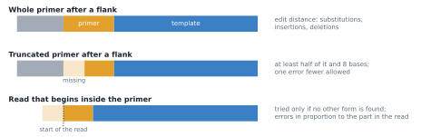

*Figure: The three forms in which a primer is found at the start of a read.*

```
PRIMER_AT_END(p, s)
1  (skip, edge) = MISSING_COSTS(p)
2  K = MAX_ERRORS(p, e)
3  hp = ALIGN_END(p, s, skip, skip, K) // whole or truncated, inside the read
4  // only then: overhanging the read
   hp = ALIGN_END(p, s, skip, edge, K) if hp == NIL
5  return hp
```

```
MISSING_COSTS(p)
    // skip[q], edge[q]: cost of an alignment that begins with q outer primer bases
    // missing, after a flank (skip) or because the read begins there (edge)
 1  L = length(p)
 2  K = MAX_ERRORS(p, e)
 3  shortest = min(L, max(⌈L / 2⌉, 8))
 4  let skip[0:L] and edge[0:L] be new arrays filled with ∞
 5  for t = 0 to L − shortest // t bases missing after a flank
 6      // one error fewer than its length allows
        K_t = K if t == 0 else max(0, ⌊ e · (L − t) ⌋ − 1)
 7      skip[t] = K − K_t
 8      for o = 0 to ⌊ (L − t) / 2 ⌋ // o more bases outside the read
 9          q = t + o
10          edge[q] = min(edge[q], K − ⌊ K_t · (L − q) / (L − t) ⌋)
11  return (skip, edge)
```

```
ALIGN_END(p, s, skip, edge, K)
 1  m = length(p)
 2  n = length(s)
 3  let D[0:m, 0:n] be a new table
 4  for j = 0 to n
 5      D[0, j] = 0 // read bases before the primer are free
 6  for q = 1 to m
 7      D[q, 0] = min(D[q − 1, 0] + 1, edge[q]) // the read begins inside the primer
 8      for j = 1 to n
 9          c = 0 if p[q] matches s[j] else 1
10          D[q, j] = min(D[q − 1, j − 1] + c,     // match or substitution
                          D[q − 1, j] + 1,         // primer base absent from the read
                          D[q, j − 1] + 1,         // extra base in the read
                          skip[q])                 // the primer begins here, q bases missing
11  best = argmin(D[m, 1:n]) // at a tie: the smallest j, the outermost
12  return NIL if D[m, best] > K
13  while best < n and D[m, best + 1] ≤ D[m, best]
14      INC(best) // extend inwards at no extra cost
15  trace the alignment back from D[m, best], preferring at each cell
            a match, then a start, then a substitution, then a gap
16  let c be the cost of the start reached
17  hp.start, hp.end = first and last read position of the alignment
18  hp.errors = D[m, best] − c
19  hp.terminus_start, hp.terminus_end = read positions of the terminus of p on the path
20  return hp
```

A truncated primer is thus allowed one error fewer than its length
would give, and an overhanging one has its allowance reduced in
proportion to the part inside the read. An overhang is tried only when
nothing else is found, as a few overhanging bases match by chance.

The alignment model is the edit distance; the primer must align
completely, and IUPAC codes match any base they stand for, in the primer
and in the read (an `N` in a read matches anything). A truncated form
must match with one error fewer because a shorter sequence matches by
chance more easily. The inner end of the alignment is extended while the
cost does not rise, so that the last primer base is not left behind when
an alignment could end one base earlier at equal cost.

**Running time and memory.**

Symbols:

- *W* window at a read end (100).

The region searched at a read end has at most *W* + 23 bases, and a
primer at most 23: nothing here depends on the length of the read.

| procedure | time | note | memory |
| --- | --- | :-: | --- |
| MISSING_COSTS | *O*(1) | ¹ | *O*(1) |
| ALIGN_END | *Θ*(*W*) | ² | *Θ*(*W*) |
| PRIMER_AT_END | *Θ*(*W*) | ³ | *Θ*(*W*) |

- ¹ Quadratic in the primer length; once per primer and run.
- ² The table: primer length × region length, about 23 × 123 cells.
- ³ One or two tables.

## A8. Search of primer-like matches inside the read

Primer-like sequences can also lie in the middle of a read: template
that resembles a primer, or a junction that was not split. They are
reported, never trimmed. Between the primers of the two ends (lines
1–4), each primer of the scheme is searched everywhere, with the errors
allowed in a primer (lines 6–7). Of matches that overlap, the best is
kept, and at most 8 in all (lines 8–10).

> **Source:** `src/seq/reads/internal-matches.c`; `search_internal` in
> `src/seq/reads/amplicon.c`

```
MATCHES_INSIDE(seq, a)
   // every match of a whole primer between the primers of the two ends
 1  lo = 1
 2  hi = length(seq)
 3  lo = a.left.end + 1 if a.left ≠ NIL
 4  hi = a.right.start − 1 if a.right ≠ NIL
 5  C = ∅
 6  for each primer p of the scheme, the left ones first
 7      C = C ∪ FIND_ALL(p, seq[lo:hi], MAX_ERRORS(p, e))
 8  M = ⟨⟩
 9  // best: fewer errors, then a left primer, then longer, then the first
    // primer of the scheme, then the first in the read
    for each c in C, best first
10      append c to M if c overlaps no match of M and length(M) < 8
11  return M sorted by start
```

These matches are reported (tag `ni`, counts) and never trimmed. A
match is found wherever it lies with respect to a better one.

The matches mark sites where a primer can anneal, and junctions of
joined amplicons that were not split.

**Running time and memory.**

Symbols:

- *n*′ length of the read (or part).

| procedure | worst case | note | typical | note | memory |
| --- | --- | :-: | --- | :-: | --- |
| MATCHES_INSIDE | *O*(*n*′) | ¹ |  |  | *O*(1) |

- ¹ One bit-parallel pass per primer. This is the step that reads the
  whole read.

## A9. Classification of the origin of each end

An amplicon should start at the very end of a segment: a terminal start.
If a primer bound inside the segment instead (internal priming), the
amplicon starts there, and its first bases are those of the primer, not
of the template. To tell the two apart, the 32 bases just inside each
primer are taken as probe (lines 1–5) and located in the references
(lines 7 and 10); the distance of the probe from the segment terminus
decides: less than 60 bases is TERMINAL, more is INTERNAL, and a probe
that is not found is UNKNOWN (ORIGIN lines 1–4).

The origin says where the amplicon began; whether the bases of the
primer may be kept there says, in addition, whether that primer binds
the segment the probe was located in (lines 9 and 13). For a universal
primer of influenza A this is always so; for one of influenza B it is
so only in the segments it was designed for.

> **Source:** `classify_ends` in `src/seq/reads/amplicon.c`

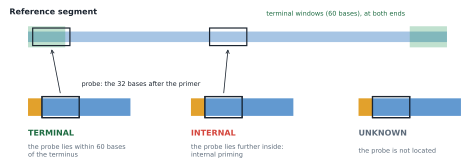

*Figure: The origin of an end is given by where its probe lies in the references.*

```
CLASSIFY_ENDS(seq, a)
    // seq is in the orientation of the amplicon
 1  lo = 1
 2  hi = length(seq)
 3  lo = a.left.end + 1 if a.left ≠ NIL
 4  hi = a.right.start − 1 if a.right ≠ NIL
 5  n = min(P, hi − lo + 1)
 6  if a.left ≠ NIL
 7      // locate the probe in the references (→ A10)
        a.left.hit = LOCATE(seq[lo:lo + n − 1])
 8      a.left.origin = ORIGIN(a.left.hit)
 9      a.left.keep_terminus = a.left.origin == TERMINAL and
            BINDS(a.left.primer, SEGMENT_OF(a.left.hit))
10  if a.right ≠ NIL
11      a.right.hit = LOCATE(RC(seq[hi − n + 1:hi]))
12      a.right.origin = ORIGIN(a.right.hit)
13      a.right.keep_terminus = a.right.origin == TERMINAL and
            BINDS(a.right.primer, SEGMENT_OF(a.right.hit))
```

BINDS(p, g) is true if the primer p binds the segment g: always for a
primer of every segment (influenza A), and for a primer of influenza B
only for the segments of its pair. A segment which is not known (a
reference whose description does not say which segment it is) is not
one of them, so the primer is removed whole there.

```
ORIGIN(hr)
1  return UNKNOWN if hr == NIL
2  // distance of the hit from the terminus it would start at (→ D5)
   if TERMINUS_DISTANCE(hr) < T
3      return TERMINAL
4  return INTERNAL
```

Both probes are read from the primer into the template. Without
references every origin is UNKNOWN.

The terminal window of 60 bases (`--terminal-window`) is generous
because deposited references often lack some terminal bases, while
internal sites lie hundreds of bases inside. Among equally good
locations of a probe the one nearest the terminus is chosen (A10), so
that an ambiguous end is never called internally primed. The position
(`reference:position:strand`, 1-based on the plus strand, first base
after the primer) is written in the tags `ml` and `mr`.

**Running time and memory.**

Symbols:
- *P* probe length (32);
- *m* total length of the references;
- *h* 10-mer seed hits of a probe.

| procedure | worst case | note | typical | note | memory |
| --- | --- | :-: | --- | :-: | --- |
| ORIGIN | *O*(1) |  |  |  | *O*(1) |
| CLASSIFY_ENDS | *O*(*h* log *h* + *m*) | ¹ | *O*(*P*) | ² | *O*(*h* + *P*) |

- ¹ Two LOCATE.
- ² *O*(*m*) for each probe without a seed (not in the Illumina preset).

## A10. Location of a probe in the references

To locate a part of a read on the references, a probe of 32 bases is
taken from it (line 1) and searched in them, on both strands (line 5),
with at most 20% errors (line 3). Aligning it to every reference would
be slow, so the k-mer index is used first (D1): the 10-mers that the
probe shares with a reference are its seeds, and give the diagonals on
which the probe may lie (line 7); the probe is aligned only to the
windows around them (lines 8–12). The location with the fewest errors
wins and, among equally good ones, the one nearest the end of the
segment (line 12; ALIGN_TO lines 6–8). If the probe has no seed, as when
each of its 10-mers holds an error, the probe is aligned to the whole of
every allowed reference (lines 14–17); this slow step is skipped for
Illumina reads (line 13). A probe shorter than 16 bases is not located
(line 2).

> **Source:** `src/seq/references/reference.c`

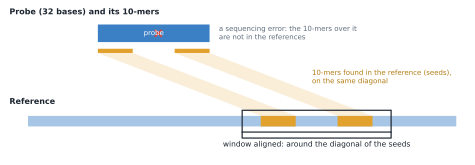

*Figure: A probe is located through its seeds: the 10-mers it shares with a reference lie on one diagonal, and the probe is aligned to the window around it.*

```
LOCATE(probe)
 1  q = probe[1:min(P, length(probe))]
 2  return NIL if length(q) < 16
 3  K = ⌊ 20% · length(q) ⌋
 4  best = NIL
 5  for each (x, σ) in ⟨(q, "+"), (RC(q), "−")⟩
 6      for each reference R of allowed // chosen for the readset (→ A3); --segment
 7          // diagonals (position in R − position in x) of the 10-mers of x in R (→ D1)
            Δ = the diagonals of DIAGONALS(index, x) that are on R
 8          for each maximal run of Δ, sorted, with gaps ≤ length(x)
 9              lo = first diagonal of the run − K
10              hi = last diagonal of the run + length(x) + K
11              k = K if best == NIL else best.errors
12              // BETTER_HIT: fewer errors, then nearer the terminus (→ D4)
                best = BETTER_HIT(best, ALIGN_TO(x, R, lo, hi, σ, k))
13  return best if best ≠ NIL or the platform is Illumina
14  for each reference R of allowed // no seed: the whole reference
15      for each (x, σ) in ⟨(q, "+"), (RC(q), "−")⟩
16          k = K if best == NIL else best.errors
17          best = BETTER_HIT(best, ALIGN_TO(x, R, 1, length(R), σ, k))
18  return best
```

```
ALIGN_TO(x, R, lo, hi, σ, k)
1  find all best alignments of the whole of x to substrings of R[lo:hi], ≤ k errors
2  return NIL if there is none
3  hr.ref = R
4  hr.strand = σ
5  hr.errors = their number of errors
6  if σ == "+" // of several equally good locations, the one nearest the terminus
7      hr.pos = the smallest start among them
8  else hr.pos = the largest end among them // first probe base, on the plus strand
9  return hr
```

Three variants are used below. `LOCATE_SEEDED(probe)` is LOCATE without
its second part, the search of whole references. `LOCATE_IN(probe, R, σ)` is
one call of ALIGN_TO over the whole of `R` on strand `σ` only, with
`k = K`. `LOCATE_WITHIN(probe, R, σ, lo, hi)` is the same over
`R[lo:hi]` (clipped to `R`).

The index only accelerates the search: it can differ from an exhaustive
one only where a better match has no exact 10-mer. `--exhaustive-search`
aligns every probe to every reference, to check the index (identical
outputs in the benchmark). The Illumina preset has no search of whole
references: probes with few errors that belong to a reference share
exact k-mers with it, and host reads would otherwise each be aligned to
every reference (3 times slower on a run of milk samples).

**Running time and memory.**

Symbols:
- *P* probe length (32);
- *m*′ length of one reference;
- *m* total length of the references;
- *w* machine word (64 bits).

*h* is the number of seed hits of the probe on both strands
(*h* ≤ 2 · 4096 · *P*).

| procedure | worst case | note | typical | note | memory | note |
| --- | --- | :-: | --- | :-: | --- | :-: |
| ALIGN_TO | *O*(*hi* − *lo*) | ¹ |  |  | *O*(*P*) |  |
| BETTER_HIT (D4) | *O*(1) |  |  |  | *O*(1) |  |
| TERMINUS_DISTANCE (D5) | *O*(1) |  |  |  | *O*(1) |  |
| LOCATE | *O*(*h* log *h* + *m*) | ² | *O*(*P*) | ³ | *O*(*h* + *P*) | ⁴ |
| LOCATE_SEEDED | *O*(*h* log *h* + *m*) |  | *O*(*P*) |  | *O*(*h* + *P*) |  |
| LOCATE_IN | *Θ*(*m*′) | ⁵ |  |  | *O*(*P*) |  |
| LOCATE_WITHIN | *Θ*(*hi* − *lo*) | ⁵ |  |  | *O*(*P*) |  |

- ¹ Linear in the window: *O*(⌈*P*/*w*⌉ · (*hi* − *lo*)).
- ² Sorting the diagonals, then windows that cover at most the
  references. Also *O*(*m*) when no seed is found and every reference
  is aligned.
- ³ A probe of a reference: *O*(*P*) seeds, *O*(1) windows of *O*(*P*)
  bases. A random 10-mer is expected *m*/4^10 times in the references,
  far less than once.
- ⁴ Per thread. The index is shared: *O*(*m*) plus a fixed table of
  4^10 entries.
- ⁵ *Θ*(⌈*P*/*w*⌉) per base of the reference aligned.

## A11. Computation of the part to keep

KEEP computes the part of the read that is kept. At an end with a
primer, the primer and everything outside it are removed (lines 6 and
10); this is also done when the origin is unknown, so that in doubt no
primer base is left. The exception is a terminal start, known only with
references: the bases of the primer which are the sequence of the
segment (the last 12 or 13 of a primer of influenza A, the last 14 to
18 of one of influenza B) are then the true end of the segment, so they
are kept and only the tail before them is removed (lines 5 and 9).

An end is terminal *for this primer* only if the primer binds the
segment the end was located in (`a.left.keep_terminus`, lines 4 and
8): the universal primers of influenza A bind every segment, those of
influenza B only the segments they were designed for, and at an end of
any other segment their bases are the primer's own sequence, as at an
internally primed end. If the two primers touch or overlap there is no
template between them (a primer dimer) and nothing is kept (lines
11–12). CUT_FACING_PRIMER handles a less frequent case: at the end of
the read where no primer was found, the other strand shows a second copy
of the primer of the opposite end, as when two amplicons are joined
without a primer between them. That copy and what lies beyond it are
removed as well (lines 1–7).

> **Source:** `compute_keep`, `cut_facing_primer` in `src/seq/reads/amplicon.c`

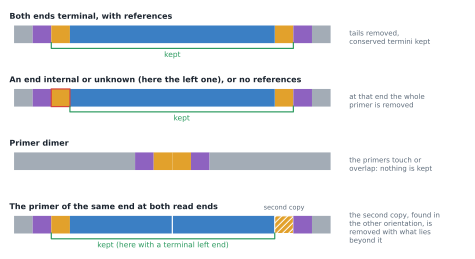

*Figure: The part of a read that is kept: with terminal ends, with an internal or unknown end, for a primer dimer, and when the primer of one end is found at both read ends.*

```
KEEP(a, n)
    // in the orientation of the amplicon; n: length of the read
 1  from = 1
 2  to = n
 3  if a.left ≠ NIL
 4      if refs ≠ NIL and a.left.keep_terminus // TERMINAL, and its
 5          from = max(1, a.left.terminus_start) // primer binds that segment
 6      else from = a.left.end + 1 // whole primer removed
 7  if a.right ≠ NIL
 8      if refs ≠ NIL and a.right.keep_terminus
 9          to = min(n, a.right.terminus_end)
10      else to = a.right.start − 1
11  if a.left ≠ NIL and a.right ≠ NIL and a.right.start ≤ a.left.end + 1
12      return (1, 0) // primer dimer: nothing is kept
13  return (from, to)
```

```
CUT_FACING_PRIMER(a, other, n)
   // other: the layout found on the opposite strand; MIRROR(i) = n + 1 − i
1  if a.right == NIL and other.left ≠ NIL
2      s = MIRROR(other.left.end) // its first base, in a's orientation
3      a.to = min(a.to, s − 1) if a.left == NIL or s > a.left.end
4  if a.left == NIL and other.right ≠ NIL
5      t = MIRROR(other.right.start) // its last base
6      if a.right == NIL or t < a.right.start
7          a.from = max(a.from, t + 1)
```

Removal is by position: the whole span of a primer alignment goes, with
everything outside it, whether or not its bases differ from the primer.
A primer base can reach the output only at an end classified TERMINAL.
CUT_FACING_PRIMER removes a primer of the same end of the scheme found
at the other end of the read (two amplicons joined without a primer
between them).

| end classified as | without references | with references |
|---|---|---|
| terminal | whole primer removed | tail removed, conserved terminus kept |
| internal | whole primer removed | whole primer removed |
| unknown | whole primer removed | whole primer removed |
| no primer found | nothing removed (unless an adapter is found) | the same |

Without references the consensus ends 12 and 13 bases short of the
segments. With references the ends are complete, but the bases there are
those of the primer: with the degenerate Uni12 the fourth base is a mix
of A and G, and where a segment differs from the primer (e.g. the 3′
end of segment 2 of A/Puerto Rico/8/1934, `CCTTGTTCCTACT`), the base of
the primer is what is kept. The boundary between tail and terminus is
taken from the alignment path, so that insertions and deletions in the
read shift it correctly. Reads shorter than `-m` after trimming are not
written.

**Running time and memory.**

| procedure | time | memory |
| --- | --- | --- |
| KEEP | *O*(1) | *O*(1) |
| CUT_FACING_PRIMER | *O*(1) | *O*(1) |

## A12. Removal of adapters and second analysis

Library adapters and barcodes lie outside the primers, and are normally
removed together with everything outside a primer. When no primer is
found at a read end, an adapter is searched there instead. FIND_ADAPTER
searches the adapters of the kits in use at that end, with at most 20%
errors (lines 2–5), also partly outside the read (lines 6–9), and takes
the one that reaches furthest into the read (lines 10–12).
REMOVE_ADAPTERS does this at each end without a primer (lines 2–5), cuts
the adapters off (lines 7–10) and analyses the rest again, now accepting
a primer only within 5 bases of where an adapter was (lines 13–15). The
second analysis is used unless it finds fewer primers than the first
(line 16).

> **Source:** `analyze_with_adapters` in `src/seq/reads/amplicon.c`;
> `src/seq/search/adapters.c`, `src/seq/search/adaptor-search.c`

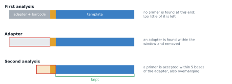

*Figure: At an end without a primer an adapter is searched and removed; the rest is analysed again, with a primer accepted only next to the adapter.*

```
REMOVE_ADAPTERS(read, a)
 1  s = NIL; t = NIL
 2  if a has no primer at the start of read
 3      s = FIND_ADAPTER(read, START)
 4  if a has no primer at the end of read
 5      t = FIND_ADAPTER(read, END)
 6  return a if s == NIL and t == NIL
 7  lo = 1
 8  hi = length(read)
 9  lo = s.end + 1 if s ≠ NIL
10  hi = t.start − 1 if t ≠ NIL
11  if hi < lo
12      return an analysis with no primer that keeps nothing
13  // next to an adapter the primer must lie within 5 bases
    w_start = 5 if s ≠ NIL else W
14  w_end = 5 if t ≠ NIL else W
15  // find the primers of both ends, their origins and the part to keep (→ A5)
    b = ANALYSE_ENDS(read[lo:hi], w_start, w_end), as positions of read
16  b = a if N_PRIMERS(b) < N_PRIMERS(a)
17  b.from = max(b.from, lo)
18  b.to = min(b.to, hi)
19  b.adapter_start = s
20  b.adapter_end = t
21  return b
```

```
FIND_ADAPTER(read, side)
 1  best = NIL
 2  for each kit in use that has an adapter d for side
 3      s = the min(length(read), W + length(d)) bases of read at side
 4      K = ⌊ 20% · number of bases of d other than N ⌋ // a barcode is 24 N
 5      hp = FIND(d, s, K)
 6      if hp == NIL and d has no barcode
 7          hp = FIND(d, s extended by ⌊ length(d) / 2 ⌋ N beyond the read end, K)
 8          if hp ≠ NIL and hp.errors > ⌊ K · (bases of hp inside the read) / length(d) ⌋
 9              hp = NIL
10      if hp ≠ NIL and hp lies within W bases of the read end
11          if best == NIL or hp reaches further into the read than best
12              best = hp
13  return best
```

The adapters are those of the Oxford Nanopore kits (`--adapters`,
default all kits; sequences from Dorado):

| kit | at the read start | at the read end |
|---|---|---|
| `nb` native barcoding | `ATTGCTAAGGTTAA` + 24-base barcode + `CAGCACCT` | reverse complement of `ATTGCTAAGGTTAA`, barcode, `CAGCACC` |
| `rbk` rapid barcoding | `GCTTGGGTGTTTAACC` + barcode + 50-base rapid adapter | none |
| `lsk` ligation | `CCTGTACTTCGTTCAGTTACGTATTGC` | `AGCAATACGTAACTGAAC` |

The barcode is searched as 24 `N`: any barcode is recognised, none is
identified. The errors allowed are 20% of the *fixed* bases (4 of the 22
of a native barcoding adapter).

An end is without a primer when the molecule is broken, or when the read
begins too far inside the primer. After the adapter is removed, a primer
remnant of a few bases is at an end, next to the adapter, where it may
overhang and is removed too. In this second analysis the primer must
lie within 5 bases of the adapter: otherwise a primer-like site of the
template within the normal window would be taken for it. The tags `a5`
and `a3` name the kit removed.

**Running time and memory.**

Symbols:
- *W* window at a read end (100);
- *w* machine word (64 bits).

*d* is the length of an adapter (at most 90) and *κ* the number of kits
(at most 3).

| procedure | time | note | memory |
| --- | --- | :-: | --- |
| FIND_ADAPTER | *O*(*κ*(*W* + *d*)) | ¹ | *O*(*W* + *d*) |
| REMOVE_ADAPTERS | 2 × FIND_ADAPTER | ² | as ANALYSE_ENDS |

- ¹ In full *O*(*κ* ⌈*d*/*w*⌉ (*W* + *d*)); constant in the length of the read.
- ² Plus one more ANALYSE_ENDS (A5) if an adapter is found.

## A13. Location of reads and ends whose probe was not located

Some reads or ends have no position on a reference: no primer was found,
or the bases next to the primer were not found in the references. For
the coverage analysis (A17) they still need one. PLACE handles a read
without any position: it locates by its seeds a probe from the middle of
the kept part, then from a quarter and from three quarters of it (lines
4–5), and places the whole read on the reference accordingly (lines
6–11). LOCATE_ENDS_FROM_INSIDE handles an end without a position.
FROM_INSIDE takes probes further and further inside the read, up to four
(lines 2–5); if the other end is known, the probe is searched only in
its reference, on the strand that fits (lines 6–7). From the probe
found, the position of the end is derived (line 10). END_POSITION
normally subtracts the bases skipped (lines 2–5). If those bases do not
match the reference there, they may be a short stretch from the end of
the segment followed by a deletion, so they are compared with the end of
the segment instead (lines 6–13). When neither end had a position and
only one is found this way, both remain without a position: one probe
alone can match by chance (LOCATE_ENDS_FROM_INSIDE lines 10–12).

> **Source:** `src/seq/reads/placement.c`; `locate_inner_ends`,
> `locate_from_inside`, `inner_end_position` in `src/seq/reads/amplicon.c`.

These positions serve the coverage analysis only: the trimming and the
origins of A9 do not change.

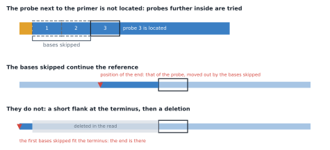

*Figure: An end is located by a probe from further inside the read; its position follows from the bases skipped, which either continue the reference or are a short flank at the terminus before a deletion.*

```
PLACE(kept)
    // a read of which no probe was located
 1  return NIL if length(kept) < 16
 2  n = min(P, length(kept))
 3  room = length(kept) − n
 4  for each o in ⟨⌊ room / 2 ⌋, ⌊ room / 4 ⌋, room − ⌊ room / 4 ⌋⟩, without repeats
 5      hr = LOCATE_SEEDED(kept[o + 1:o + n]) // as LOCATE, by 10-mer seeds only (→ A10)
 6      if hr ≠ NIL
 7          if hr.strand == "+"
 8              from = hr.pos − o
 9              return (hr.ref, from, from + length(kept) − 1, hr.strand)
10          else to = hr.pos + o
11              return (hr.ref, to − length(kept) + 1, to, hr.strand)
12  return NIL
```

```
LOCATE_ENDS_FROM_INSIDE(read, a)
 1  t = the bases of read between the primers of a
            // at an end without a primer: up to the end of the kept part
 2  // POSITION(x): x.hit if x has a primer and x.hit ≠ NIL, else x.inner
    left_known = POSITION(a.left) ≠ NIL
 3  right_known = POSITION(a.right) ≠ NIL
 4  if not left_known
 5      a.left.inner = FROM_INSIDE(t, a.left, POSITION(a.right))
 6  if not right_known
 7      a.right.inner = FROM_INSIDE(t, a.right, POSITION(a.left))
 8  if not right_known and POSITION(a.left) == NIL and POSITION(a.right) ≠ NIL
 9      a.left.inner = FROM_INSIDE(t, a.left, POSITION(a.right))
10  if not left_known and not right_known
11      if a.left.inner == NIL or a.right.inner == NIL
12          a.left.inner = a.right.inner = NIL // one probe alone can be a chance match
```

```
FROM_INSIDE(t, x, other)
    // t is oriented so that x is its first base and probes are read inwards
 1  n = length(t)
 2  for i = 0 to 3
 3      shift = i · P
 4      return NIL if shift + 2 · P > n // keep clear of the other end's probe
 5      probe = t[shift + 1:shift + P]
 6      // align the probe to one whole reference, on one strand (→ A10)
        // as LOCATE, by 10-mer seeds only (→ A10)
        if other ≠ NIL
 7          hr = LOCATE_IN(probe, other.ref, the strand opposite to other.strand)
 8      else hr = LOCATE_SEEDED(probe)
 9      if hr ≠ NIL
10          hr.pos = END_POSITION(t[1:shift], x, hr)
11          return hr
12  return NIL
```

```
END_POSITION(skipped, x, hr)
    // skipped: the bases between the end x and the probe located at hr
 1  shift = length(skipped)
 2  continued = hr.pos − shift if hr.strand == "+" else hr.pos + shift
 3  return continued if x has no primer or shift == 0
 4  if FLANK_DIFFERENCES(skipped, hr.ref, ending next to the probe) ≤ 30% · shift
 5      return continued // the bases continue the reference
 6  best = ∞ // they do not: a short flank at the terminus, then a deletion?
 7  for d = −8 to 21 // around the first template base
 8      z = d + 1 if hr.strand == "+" else length(hr.ref) − d
 9      c = FLANK_DIFFERENCES(skipped, hr.ref, beginning at z)
10      if c < best
11          best = c
12          best_z = z
13  return best_z if best ≤ 40% · shift
14  return continued
```

`FLANK_DIFFERENCES(x, R, anchor)` is the smallest edit distance of `x`
to a stretch of `R` that begins (or ends) at the anchor, computed
within a band of `8 + ⌊length(x) / 8⌋` diagonals.

Why ends lack a position: the first bases after a primer are
untranslated region and the start of the coding sequence, where a sample
can differ much from a reference. The span of such a read cannot be
told from its length either: a read with an internal deletion is much
shorter than the distance between its ends.

The placement by a probe from inside is approximate (the insertions and
deletions of the rest of the read are ignored); without it, most of an
Illumina library would be absent from the coverage analysis. In
END_POSITION the
terminus is tried from 8 bases before its first base to 21 after, as a
reference can lack terminal bases or have a few more; flanks of 16 bases
before a deletion are frequent in real samples. The origin of an end
located from inside stays UNKNOWN.

**Running time and memory.**

Symbols:
- *n*′ length of the read (or part);
- *P* probe length (32);
- *m*′ length of one reference;
- *m* total length of the references;
- *h* 10-mer seed hits of a probe.

| procedure | worst case | note | typical | note | memory |
| --- | --- | :-: | --- | :-: | --- |
| PLACE | *O*(*h* log *h* + *m*) | ¹ | *O*(*P*) |  | *O*(*h* + *P*) |
| END_POSITION | *O*(*P*²) | ² | *O*(*P*²/8) | ³ | *O*(*P*) |
| FROM_INSIDE | *O*(*m*′ + *P*²) | ⁴ | *O*(*m*′) | ⁵ | *O*(*m*′ + *P*) |
| LOCATE_ENDS_FROM_INSIDE | 3 × FROM_INSIDE |  | *O*(1) | ⁶ | *O*(*n*′ + *m*′) |

- ¹ Three LOCATE_SEEDED.
- ² 31 banded alignments of at most 3*P* bases.
- ³ One alignment, when the bases continue the reference; *O*(1) for the
  first probe.
- ⁴ Four probes, with the other end known (LOCATE_IN). Without it:
  *O*(*h* log *h* + *m* + *P*²).
- ⁵ The first probe is located; *O*(*P*) when it is searched by seeds.
- ⁶ When both probes were located in A9.

## A14. Location of the junction of an internal deletion

Some genomes have a large internal deletion (defective viral genomes). A
read from one has its two ends far apart on the reference but too few
bases between them: DELETION_EXPECTED flags a read that is short by more
than 100 bases and by more than a tenth of the distance. FIND_JUNCTION
then locates the junction of the deletion in the read. Both ends must
lie on the same reference, on opposite strands (lines 1–4). The read
follows the reference from its left end up to the junction, then again
from a point further on up to its right end: these are the two flanks,
each on its own diagonal (lines 11–12). A probe is taken from the middle
of the part not yet assigned (line 18) and aligned where the left flank
would have it and where the right one would (lines 22–23). If it lies on
the left flank, the junction is to its right; if on the right flank, to
its left. This bisection halves the unassigned part (lines 24–31) and is
repeated (line 17). If a probe fits neither flank its two neighbours are
tried (line 20), and if none can be assigned to a flank, the bisection
stops. The bases that remain are aligned to both flanks by banded
dynamic programming, and the junction is put where the two alignments
together have the fewest errors (JUNCTION_BY_ALIGNMENT lines 3–8). It is
reported only if the fit is good (line 9) and at least 100 bases are
missing (line 12).

> **Source:** `src/seq/reads/junction.c`; `find_junction` in `src/seq/reads/amplicon.c`

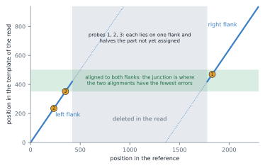

*Figure: A read with an internal deletion lies on two diagonals of the reference, one for each flank. Each probe of the bisection lies on one of them; the bases left between the probes are aligned to both.*

```
FIND_JUNCTION(read, a)
 1  l = POSITION(a.left)
 2  r = POSITION(a.right)
 3  if l == NIL or r == NIL or l.ref ≠ r.ref or l.strand == r.strand
 4      return NIL
 5  R = l.ref
 6  t = the template of read (between the primers), oriented as the plus strand of R
 7  n = length(t)
 8  first, last = positions on R of t[1] and t[n], from l and r
 9  deleted = last − first + 1 − n
10  return NIL if not DELETION_EXPECTED(n, last − first + 1)
11  // a diagonal δ places t[i] at R[δ + i]
    left = first − 1                               // diagonal of the left flank
12  right = last − n // diagonal of the right flank
13  tol = min(20 + ⌊ n / 10 ⌋, ⌊ (deleted − 1) / 2 ⌋)
14  lo = 0 // offset of the last probe known on the left
15  hi = max(0, n − P) // ... of the first known on the right
16  told = TRUE
17  while told and hi − lo > 2 · P + 1
18      mid = lo + ⌊ (hi − lo) / 2 ⌋
19      told = FALSE
20      for each o in ⟨mid, mid + P, mid − P⟩
21          if not told
22              // the probe, where each flank would have it
                x = ON_FLANK(t, R, o, left, tol)
23              y = ON_FLANK(t, R, o, right, tol)
24              if x ≠ NIL and (y == NIL or x.errors ≤ y.errors)
25                  told = TRUE
26                  lo = o
27                  left = x.pos − o − 1
28              elseif y ≠ NIL
29                  told = TRUE
30                  hi = o
31                  right = y.pos − o − 1
32  return JUNCTION_BY_ALIGNMENT(t, R, lo + 1, min(hi + P, n), left, right)
```

```
DELETION_EXPECTED(n, distance)
   // n template bases whose ends lie distance bases apart on the reference
1  return distance − n > max(100, ⌊ distance / 10 ⌋)
```

```
ON_FLANK(t, R, o, δ, tol)
   // the probe at offset o of t, if it lies within tol of the diagonal δ
1  expected = δ + o + 1
2  // align the probe to a window of one reference, on one strand (→ A10)
   hr = LOCATE_WITHIN(t[o + 1:o + P], R, "+", expected − tol, expected + tol + 2 · P)
3  return NIL if hr == NIL or |hr.pos − expected| > tol
4  return hr
```

```
JUNCTION_BY_ALIGNMENT(t, R, u, v, left, right)
    // the junction lies among t[u:v]
 1  m = v − u + 1
 2  band = 8 + ⌊ m / 8 ⌋
 3  for i = 0 to m
 4      L[i] = least edit distance of t[u:u + i − 1] to R[left + u:y], over y, within band
 5      y_left[i] = that y
 6      G[i] = least edit distance of t[v − i + 1:v] to R[y:right + v], over y, within band
 7      y_right[i] = that y
 8  s = argmin over i of (L[i] + G[m − i]) // at a tie: the smallest i
 9  return NIL if L[s] + G[m − s] > 30% · m
10  j.left_end = y_left[s] // last base of R in the left flank
11  j.right_start = y_right[m − s] // first base of R in the right flank
12  return NIL if j.right_start − j.left_end − 1 < 100
13  return j
```

Taking the *smallest* minimizing `i` gives bases that fit both flanks
(a short repeat at the junction) to the right flank. A probe is aligned
only where one of the two flanks would have it: a match elsewhere in
the reference would not tell its flank. The bisection stops as soon as
a probe does not tell its flank (it contains the junction, or the
sample differs too much there); the alignment then runs over whatever
lies between the probes known so far.

The two allowances of DELETION_EXPECTED: the 100 bases cover what a
sample can lack of its reference (e.g. 60 bases in the stalk of a
neuraminidase), the 10% the insertions and deletions of a long noisy
read. Reads with such deletions come from defective interfering
genomes. The junction does not change the trimming; it lets each flank
be counted where it lies.

**Running time and memory.**

Symbols:
- *n*′ length of the read (or part);
- *P* probe length (32);
- *m*′ length of one reference.

*ℓ* = *v* − *u* + 1 is the number of bases aligned (`m` in the code).

| procedure | worst case | note | typical | note | memory | note |
| --- | --- | :-: | --- | :-: | --- | :-: |
| DELETION_EXPECTED | *O*(1) |  |  |  | *O*(1) |  |
| JUNCTION_BY_ALIGNMENT | *Θ*(*ℓ*²/8 + 8*ℓ*) | ¹ |  |  | *O*(*ℓ*) | ² |
| ON_FLANK | *O*(*P* + *n*′) | ⁵ |  |  | *O*(*P*) |  |
| FIND_JUNCTION | *O*(*n*′ log *n*′ + *n*′²) | ³ | *O*(*P* log *n*′ + *P*²) | ⁴ | *O*(*n*′) |  |

- ¹ *ℓ* bases times the band, twice (once from each side).
- ² Two rows of the band and four arrays of *ℓ* + 1.
- ³ Bisection: *O*(log(*n*′/*P*)) steps of at most six ON_FLANK. The
  *n*′² term: the first probe does not tell its flank, and the whole
  template is aligned.
- ⁴ The bisection ends with at most 3*P* + 1 bases to align.
- ⁵ A window of 2 · tol + 2*P* bases, with tol ≤ 20 + *n*′/10.

## A15. Clustering of internal priming sites

Each end classified INTERNAL has a position on its reference: the first
base after the primer. COUNT_SITE counts the reads that start at each
position (lines 1–2). Sequencing errors shift a start by a few bases, so
SITES clusters the positions that are at most 5 apart into one site
(lines 5–15), named after its position with most reads (lines 12–13),
and lists the sites, the most used first (line 17).

> **Source:** `count_end` in `src/analysis/counter.c`; `add_sites` in
> `src/reports/report.c`

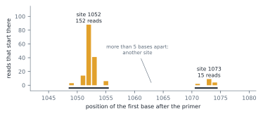

*Figure: Starts of internally primed reads at each position (an example), clustered into sites: positions at most 5 bases apart, named after the one with most reads.*

```
COUNT_SITE(rs, a)
1  for each end x of a with x.origin == INTERNAL
2      // x.hit.pos: the first base after the primer
       INC(rs.starts[x.hit.ref, x.side, x.hit.pos])
```

```
SITES(rs)
 1  S = ⟨⟩
 2  for each reference R and each side
 3      c = rs.starts[R, side]
 4      site = NIL
 5      for p = 1 to length(R)
 6          if c[p] > 0
 7              if site ≠ NIL and p − site.to > 5
 8                  append site to S
 9                  site = NIL
10              if site == NIL
11                  site = a new site with from = p, position = p, reads = 0
12              elseif c[p] > c[site.position]
13                  site.position = p // the position with most reads
14              site.to = p
15              INC(site.reads, c[p])
16      append site to S if site ≠ NIL
17  return S sorted by decreasing reads
```

**Running time and memory.**

Symbols:

- *m* total length of the references.

*S* is the number of sites.

| procedure | time | note | memory | note |
| --- | --- | :-: | --- | :-: |
| COUNT_SITE | *O*(1) per read |  | *Θ*(*m*) | ¹ |
| SITES | *Θ*(*m*) + *O*(*S* log *S*) | ² | *O*(*S*) |  |

- ¹ Two counts per reference position, whatever the number of reads.
- ² A walk over the positions, then the sort of the sites.

## A16. Histogram of the lengths of complete amplicons

In a read with both primers, the bases between them are the whole
amplicon, so their number is its length (lines 1–3). The lengths are
collected in a histogram with bins of 10 bases for each reference: that
of the left end, else that of the right end, else a histogram of the
reads not located (lines 4–10). With references, SHORT_COMPLETE counts
the complete amplicons shorter than 90% of their reference, as those of
internally primed amplicons and of genomes with a deletion are (lines
2–4). Without references, PEAKS reports the most frequent lengths
instead: the bins with at least 2% of the amplicons that are higher than
their neighbours (lines 3–5).

> **Source:** `count_length` in `src/analysis/counter.c`; `src/analysis/lengths.c`

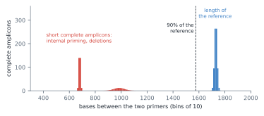

*Figure: Lengths of the complete amplicons of a segment (an example): those shorter than 90% of the reference are counted as short.*

```
COUNT_LENGTH(rs, a)
 1  return if a.left == NIL or a.right == NIL
 2  ℓ = a.right.start − a.left.end − 1 // bases between the two primers
 3  return if ℓ ≤ 0
 4  if a.left.hit ≠ NIL
 5      k = a.left.hit.ref
 6  elseif a.right.hit ≠ NIL
 7      k = a.right.hit.ref
 8  else k = NOT_LOCATED
 9  b = ⌊ min(ℓ, 4000) / 10 ⌋
10  INC(rs.hist[k, b])
```

```
SHORT_COMPLETE(rs, R)
   // with references: amplicons shorter than 90% of the reference
1  count = 0; b = 0
2  while (b + 1) · 10 ≤ 90% · length(R)
3      INC(count, rs.hist[R, b])
4      INC(b)
5  return count, and the fullest of the bins summed
```

```
PEAKS(rs, k)
   // without references
1  total = sum(rs.hist[k, b]) // over all b
2  S = ⟨⟩
3  for each bin b with rs.hist[k, b] > 0 and rs.hist[k, b] ≥ 2% · total
4      if no bin within 5 bins of b is higher, and no earlier one is equal
5          append b to S
6  return S sorted by decreasing rs.hist[k, b]
```

The reference length, not the modal length, is the yardstick:
internally primed amplicons can be the majority.

The length check is independent of the classification of the ends.
Internal priming appears as a second peak at the distance from the
internal site to the end of the segment (670–679 bases for the HA
site); deletions appear here as well.

**Running time and memory.**

Symbols:

- *M* number of references.

The histograms have a fixed number of bins (401: lengths 0 to 4000 in
bins of 10).

| procedure | time | note | memory | note |
| --- | --- | :-: | --- | :-: |
| COUNT_LENGTH | *O*(1) per read |  | *Θ*(*M*) | ¹ |
| SHORT_COMPLETE | *O*(1) | ² | *O*(1) |  |
| PEAKS | *O*(1) | ³ | *O*(1) |  |

- ¹ One histogram per reference.
- ² One pass over the bins.
- ³ 11 neighbours for each bin.

## A17. Construction of the coverage profiles by read origin

The coverage profile of a segment is its depth at each position, by read
origin. COVER represents each read as one span on its reference, from
the position of one end to that of the other, without aligning its
bases. The span is taken from the best information available: both ends
(lines 9–11); one end and the length of the read (lines 12–16 and
24–32); or a probe from inside the read (lines 34–36). A complete
amplicon that was not located draws nothing, even when exactly one
reference has a fitting length: the length does not say which segment
the read is, so the read is counted apart, as *not placed* (line 39).
Any other read that was not located is not drawn either (line 40). The
category is the origin of the 5′ end of the amplicon: terminal,
internal or without primer (lines 17–23, 33 and 37). A read with an
internal deletion is drawn as two spans, one for each flank, in a
category of its own (lines 41–46); the others go to their category, by
strand (lines 47–49). An internal priming site shows in the coverage
plot as a step in the depth of the internal category.

> **Source:** `count_cover` in `src/analysis/counter.c`

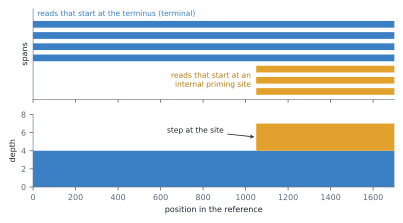

*Figure: Each read is one span on its reference, in the category of its origin; the depth of a category is the number of its spans over a position.*

```
COVER(rs, a)
 1  span = a.to − a.from + 1
 2  l = POSITION(a.left) // the 5' end of the amplicon
 3  r = POSITION(a.right)
 4  near = 60 + ⌊ span / 20 ⌋
 5  both = FALSE
 6  if l ≠ NIL
 7      R = l.ref
 8      both = r ≠ NIL and r.ref == l.ref
 9      if both
10          from = min(l.pos, r.pos)
11          to = max(l.pos, r.pos)
12      elseif l.strand == "+"
13          from = l.pos
14          to = from + span − 1
15      else to = l.pos
16          from = to − span + 1
17      // distance of the hit from the terminus it would start at (→ D5)
        if a.left has no primer
18          c = NO_PRIMER
19      elseif a.left.hit ≠ NIL
20          c = a.left.origin
21      elseif TERMINUS_DISTANCE(l) < near
22          c = TERMINAL
23      else c = INTERNAL
24  elseif r ≠ NIL
25      R = r.ref
26      if r.strand == "−"
27          to = r.pos
28          from = to − span + 1
29          start = from − 1 // distance of the 5' end from its terminus
30      else from = r.pos
31          to = from + span − 1
32          start = length(R) − to
33      // ORIGIN_BY_DISTANCE: no primer; else terminal if start ≤ near, else internal (→ D6)
        c = ORIGIN_BY_DISTANCE(a, start, near)
34  elseif a.placement ≠ NIL
35      (R, from, to) = a.placement
36      start = distance of the 5' end of the amplicon from its terminus of R
37      c = ORIGIN_BY_DISTANCE(a, start, near)
38  elseif a.left has a primer and a.right has a primer and span > 0
            and exactly one reference R has |length(R) − span| ≤ 80,
            the next nearest being at least 80 further
39      return UNPLACED // of the length of a segment, on none: not drawn
40  else return // not drawn
41  if both and a.junction ≠ NIL // is the template much shorter than its span? (→ A14)
42      // ADD_SPAN: one more span of a category on from:to of R (→ D6)
        ADD_SPAN(rs, R, DELETION, from, a.junction.left_end)
43      ADD_SPAN(rs, R, DELETION, a.junction.right_start, to)
44  elseif both and DELETION_EXPECTED(span, to − from + 1)
45      ADD_SPAN(rs, R, DELETION, from, from + ⌊ span / 2 ⌋ − 1)
46      ADD_SPAN(rs, R, DELETION, to − ⌈span / 2⌉ + 1, to)
47  elseif c == NO_PRIMER
48      ADD_SPAN(rs, R, c, from, to)
49  else ADD_SPAN(rs, R, c with the strand of the read (+ or −), from, to)
```

The depth of category `c` at position `x` is the number of spans begun
at or before `x` minus the number ended before `x`. It is built from
probe positions, not from a base-by-base alignment; part B measures how
close it is.

| category | meaning |
|---|---|
| terminal +, terminal − | started at a segment end, by strand |
| internal +, internal − | internally primed, by strand |
| no 5′ primer | a fragment of unknown origin |
| internal deletion | covers only its two flanks, up to the junction (or half the template at each end if the junction was not found) |

A read that is *not placed* has no category here: it draws no depth. It
is counted in the reads of the sample and written to its own file by
`--by-category`.

On ten Nanopore samples the coverage profiles were compared with those
from full alignments (part B; `notes/coverage_inner_ends`).

**Running time and memory.**

Symbols:
- *M* number of references;
- *m*′ length of one reference;
- *m* total length of the references.

| procedure | time | note | memory | note |
| --- | --- | :-: | --- | :-: |
| ORIGIN_BY_DISTANCE (D6) | *O*(1) |  | *O*(1) |  |
| ADD_SPAN (D6) | *O*(1) |  | *O*(1) |  |
| COVER | *O*(1) per read | ¹ | *Θ*(*m*) | ² |
| depth of a reference | *Θ*(*m*′) | ³ | *Θ*(*m*′) |  |

- ¹ *O*(*M*) for a complete amplicon without a location: its length is
  compared with every reference length.
- ² Two counts per position for each of the 7 categories, whatever the
  number of reads.
- ³ A running sum per category.

---

# B. Checking flucut against full alignments (`flucut-posthoc`)

The trimming of part A decides about a read from little of it: the
primer matches at its ends and a few probes of 32 bases. Whether those
decisions are right cannot be seen from its output. In this part they
are checked on real samples against a second, more complete source of
evidence. Every read is aligned in full to the references with minimap2,
the amplicons it holds are built from its alignments, and what was
reported for the read (its parts, the primer and the origin of each end,
their positions, the bases removed) is compared with what the alignments
show.

The sections follow the order of the analysis, which B1 gives for a
whole sample:

- the references are chosen and adapted to the sample (B2), and the
  reads are mapped to them (B3);
- primers are searched at the boundaries of the alignments, together
  with control sequences that measure how often one is found by chance
  (B4);
- the alignments of a read are joined into amplicons (B5), and the
  reads that do not map are classified (B6);
- the comparison is made read by read (B7) and on the summaries of a
  sample: internal priming sites, amplicon lengths and coverage
  profiles (B8);
- the reads that the assembler IRMA used are compared with the same
  amplicons (B9).

A full alignment is not a ground truth either: it depends on the reference
and on the aligner. For real reads it is the best estimate there is;
reads in which the origin of every base is known are simulated in
part C.

Source: `posthoc/flucut_posthoc/`. In this part *left* and *right*
are those of the plus strand of the reference.

## B1. Analysis of a sample

The trimming is checked on real reads, of which the true origin is not
known, by the slow step that the trimming itself avoids: aligning every
read in full to the references. First the references are chosen and
adapted to the sample (lines 1–3). For each read, the amplicons it holds
are then built from its alignments (line 6) and classified, or the read
itself if nothing maps (lines 7–9). This is compared with what was
written about the read when it was trimmed (line 10) and with what IRMA
did with it (line 11). At the end the counts are summarized (line 12).

> **Source:** `pipeline.py`, `analysis.py`

```
POSTHOC(reads, all_refs, flucut_output, irma_runs)
    tags = for each read, the kept length and tags of each part flucut wrote
 1  // keep, per segment, the reference the reads map to best (→ B2)
    refs = CHOOSE_REFERENCES(all_refs, reads)
 2  // give the references the majority bases of the sample (→ B2)
    refs = ADAPT_REFERENCES(refs, reads)
 3  // map positions of the other references to the chosen ones (→ B2)
    lift = POSITION_MAPS(refs, all_refs)
 4  set to zero the tables of counts of the sample: measured, written, split, category,
            origin, position, trim, irma, same_segment
 5  for each read r, with all its alignments A from minimap2 to refs
 6      U = UNITS(A) // build the amplicons of the read from its alignments (→ B5)
 7      if U == ⟨⟩ // coverage category of the amplicon (→ B5)
 8          CLASSIFY_UNMAPPED(r) // classify the read by the primers at its ends (→ B6)
 9      else for each unit u of U
                count CATEGORY(u), its two ends, its length and its deletions
                add each block of u to measured[u.ref, CATEGORY(u)]
10      // count the agreement of flucut's tags with the amplicons (→ B7)
        COMPARE_READ(tags[r], the amplicons of r, lift)
11      // count which reads IRMA used, and on which segment (→ B9)
        COMPARE_IRMA(r, U, irma_runs)
12  summarize the sites, lengths, coverage profiles and agreement
```

**Running time and memory.**

Symbols:
- *n*′ length of the read (or part);
- *N* reads in the readset;
- *n* total bases of those reads;
- *m* total length of the references.

minimap2 is an external heuristic: its cost, roughly linear in the
bases mapped for references this small, is not analysed here. *a* is
the number of alignments of a read.

| procedure | time | note | memory | note |
| --- | --- | :-: | --- | :-: |
| POSTHOC | mapping + *O*(*n*) | ¹ | *O*(*N* + *m*) | ² |

- ¹ *O*(*an*′) per read (B5), for bounded *a*. Batches of 2000 reads are
  analysed in parallel.
- ² *O*(*N*): the tags of flucut and the read names of each IRMA run,
  held for all reads. *O*(*m*): the coverage profiles. The rest is per
  batch.

## B2. Choice and adaptation of the references

The alignments depend on how close the reference is to the sample.
CHOOSE_REFERENCES maps the first 20,000 reads to all references and
keeps, for each segment, the one with most matching bases (lines 1–8).
ADAPT_REFERENCES then adapts it to the sample: the reads are mapped, and
wherever most reads agree on a base that differs from the reference, the
base of the reference is replaced (lines 4–13). This is repeated up to 4
times, until almost nothing changes (line 14). The ends of the reads are
left out, as they can be primer (line 7). TERMINI notes whether a
reference includes the conserved ends of its segment, and where its
template begins and ends (lines 1–6). POSITION_MAPS translates the
positions on the references not chosen, which flucut may have used, to
those of the chosen one, by aligning the two (lines 1–5).

> **Source:** `references.py`

```
CHOOSE_REFERENCES(all_refs, reads)
1  map the first 20,000 reads to all_refs // minimap2 -x map-ont --secondary=no
2  matches = [0, 0, 0, ...] // for each R in all_refs
3  for each alignment x
4      INC(matches[x.ref], matching bases of x)
5  chosen = ⟨⟩
6  for each segment s
7      R = argmax(matches[R]) // over the references R of s
8      append R to chosen if matches[R] > 0
9  return chosen
```

```
ADAPT_REFERENCES(chosen, reads)
 1  sample = the first 200,000 reads
 2  for round = 1 to 4
 3      changed = 0
 4      map sample to chosen // the options of B3
 5      let n[R, x, b] = 0 for each reference R, position x and base b
 6      for each alignment, each aligned pair (read position q, reference position x)
 7          INC(n[R, x, read[q]]) if q is not among the first or last 20 aligned read bases
 8      for each R of chosen, each position x of R outside its conserved termini
 9          depth = sum(n[R, x, b]) // over b
10          b* = argmax over the bases b of n[R, x, b]
11          if depth ≥ 5 and 2 · n[R, x, b*] > depth and R[x] ≠ b*
12              R[x] = b*
13              INC(changed)
14      return chosen if changed < 3
15  return chosen
```

Only substitutions are applied, so positions stay those of the database
record. The 20 bases left out at each read end are those that can be
primer-derived: at a strong internal priming site they would write the
primer into the reference.

```
TERMINI(R)
   // bases of the conserved termini present at the two ends of R
1  hp = FIND("AGCRAAAGCAGG", R[1:20], 2)
2  R.t12 = 0 if hp == NIL else hp.end
3  hp = FIND("CCTTGTTTCTACT", R[length(R) − 20:length(R)], 2)
4  R.t13 = 0 if hp == NIL else length(R) − hp.start + 1
5  R.first_template = R.t12 + 1
6  R.last_template = length(R) − R.t13
```

```
POSITION_MAPS(chosen, all_refs)
1  for each reference O of all_refs not chosen, of a segment with a chosen reference C
2      align O to C // minimap2 -c, the options of B3
3      for each aligned pair (x in O, y in C)
4          map[O, x] = y
5      positions of O in an insertion or beyond the alignment continue
               from the nearest aligned position
6  return map
```

**Running time and memory.**

Symbols:
- *M* number of references;
- *m*′ length of one reference;
- *m* total length of the references.

*b* is the number of bases of the reads sampled.

| procedure | time | note | memory | note |
| --- | --- | :-: | --- | :-: |
| CHOOSE_REFERENCES | mapping + *O*(*M*) | ¹ | *O*(*M*) |  |
| ADAPT_REFERENCES | ≤ 4 × (mapping + *O*(*b* + *m*)) | ² | *Θ*(*m*) | ³ |
| TERMINI | *O*(1) | ⁴ | *O*(1) |  |
| POSITION_MAPS | alignment + *O*(*m*′) | ⁵ | *Θ*(*m*′) | ⁵ |

- ¹ Of 20,000 reads; then one step per alignment.
- ² Of 200,000 reads, once per round.
- ³ Five counts per reference position.
- ⁴ 20 bases at each end.
- ⁵ For each reference not chosen.

## B3. Mapping of the reads

The reads are mapped with minimap2, with options set so that short
amplicons map too, and so that a read from a genome with a deletion
gives two separate alignments, one for each flank.

> **Source:** `mapping.py`

```sh
minimap2 -a -Y -x map-ont -k 12 -w 6 -g 100 -r 100,100 --secondary=no -s 30 -m 25
```

Short k-mers so that short templates map. Chains are not joined over
gaps above 100 bases, so the two flanks of a deleted genome come out as
two alignments, joined in B5. Each alignment `x` has `x.ref`,
`x.strand`, the read interval `x.qs:x.qe` and the reference interval
`x.rs:x.re`, in the orientation of the reference, and its blocks
split at every insertion and deletion, so that `REF_OF(x, q)` gives the
reference position aligned to read position `q`.

**Running time and memory.**

Symbols:

- *n*′ length of the read (or part).

REF_OF takes *O*(log *q*) by binary search among the *q* blocks of an
alignment; the blocks take *O*(*q*) memory, *q* ≤ *n*′.

## B4. Search of primers at alignment boundaries, and chance matches

Where an alignment of a read begins or ends, an amplicon began or ended,
and a primer should lie just outside. PRIMER_AT searches the conserved
bases of the primers in the read next to that boundary (lines 2–7) with
at most 20% errors, also when the read begins inside the primer (lines 6
and 8–9), and keeps the match with the lowest error rate, then the
nearest to the boundary (lines 10–12). ALLOWED_GAP gives the largest
distance of the primer from the boundary: 10 bases more than the bases
the alignment lacks up to the end of the segment, 40 more if the
reference has no terminus, and just 10 if the alignment stops far from
the end of the segment (lines 1–3). SEARCH_BOUNDARIES does this at both
ends of an alignment (lines 2–5). To know how often a primer is found by
chance, it searches in the same places three control sequences, the
bases of the primer in another order, which cannot be real primers
(lines 6–8). CHANCE_RATE is the median share of the searches in which a
control is found (lines 1–3).

> **Source:** `primers.py`; `_searched`, `_allowed_gap` in
> `amplicons.py`

Only the conserved termini are searched (`AGCRAAAGCAGG`,
`AGTAGAAACAAGG`), so the result does not depend on the primer scheme.

```
SEARCH_BOUNDARIES(x, R)
    // x: an alignment of a read, as oriented on R
 1  s = x.seq
 2  left_gap = ALLOWED_GAP(x.rs − R.first_template, R.t12 > 0)
 3  right_gap = ALLOWED_GAP(R.last_template − x.re, R.t13 > 0)
 4  x.left = PRIMER_AT(s, x.qs, left_gap, primers)
 5  x.right = PRIMER_AT(RC(s), length(s) − x.qe + 1, right_gap, primers)
 6  for i = 1 to 3
 7      x.left_control[i] = PRIMER_AT(s, x.qs, left_gap, controls[i]) ≠ NIL
 8      x.right_control[i] = PRIMER_AT(RC(s), length(s) − x.qe + 1, right_gap, controls[i]) ≠ NIL
 9  if x.left == NIL
10      // detect a flank too short to map, before a deletion (→ B5)
        x.left_flank = SHORT_FLANK(x, R, LEFT)
11  x.right_flank = SHORT_FLANK(x, R, RIGHT) if x.right == NIL
```

```
ALLOWED_GAP(distance, has_terminus)
   // distance: bases between the terminus of the segment and the alignment
1  return 10 if distance > 40 // template clipped by the aligner
2  return max(0, distance) + 10 if has_terminus
3  return max(0, distance) + 40 // the reference lacks its terminus
```

```
PRIMER_AT(seq, boundary, gap, oligos)
    // boundary: the first aligned base of an alignment of seq
 1  best = NIL
 2  for each sequence o of oligos
 3      m = length(o)
 4      K = ⌊ 20% · m ⌋
 5      s = seq[boundary − m − gap:boundary + m + 2]
 6      // the read may begin inside the primer
        prepend m − 8 N to s if s reaches the start of seq
 7      for each best location hp of FIND(o, s, K)
 8          missing = bases of o aligned to the N prepended
 9          if hp.errors ≤ ⌊ 20% · (m − missing) ⌋
                    and at least 6 bases of seq are under hp
                    and boundary − 1 − hp.end ≤ gap
10              score = (hp.errors / (m − missing), |boundary − 1 − hp.end|)
11              if best == NIL or score < best.score
12                  best = hp, with its score
13  return best
```

Each control is the bases of a primer in another order, at least 5
edits from the primers, their usual tails and their reverse
complements: its hits are chance matches. Three are used for each
primer, because one can resemble an adapter of a library.

```
CHANCE_RATE(context)
1  for i = 1 to 3
2      rate[i] = hits of control i in context / searches in context
3  return the median of rate[1:3]
```

**Running time and memory.**

Symbols:
- *n*′ length of the read (or part);
- *w* machine word (64 bits).

*ℓ* is the length of a terminus (12 or 13) and *gap* is at most 80.

| procedure | time | note | memory |
| --- | --- | :-: | --- |
| ALLOWED_GAP | *O*(1) |  | *O*(1) |
| PRIMER_AT | *O*(*ℓ* + *gap*) | ¹ | *O*(*ℓ* + *gap*) |
| SEARCH_BOUNDARIES | *Θ*(*n*′) | ² | *Θ*(*n*′) |
| CHANCE_RATE | *O*(1) |  | *O*(1) |

- ¹ Per sequence, in full *O*(⌈*ℓ*/*w*⌉ (2*ℓ* + *gap*)); constant in the
  length of the read.
- ² 16 searches, and the reverse complement of the read.

## B5. Construction of amplicons from alignments

A read gives one or more alignments, and one amplicon (a unit) can
consist of several, such as the two flanks of a deletion. UNITS keeps
the alignments of at least 30 bases, in the order of the read (line 1),
searches the primers at their boundaries (lines 2–3) and chains the
consecutive alignments that belong together (lines 5–8). JOINED decides
that: same reference and strand (line 1), no primer between the two
(lines 2–3), and both advancing along the read and the reference (line
4). MAKE_UNIT turns a chain into an amplicon. Its two ends have a primer
or not, and are terminal if within 10 bases of the end of the template,
else internal (lines 5–13). Its blocks are the stretches of the
reference it covers, with the deletions of at least 100 bases between
them (lines 20–29). SHORT_FLANK recovers a flank too short to be mapped
before a deletion: a primer followed by a few bases that match the start
of the segment (lines 1–6; MAKE_UNIT lines 14–18). CATEGORY names the
amplicon with the categories of the coverage analysis (A17): deletion,
internal, terminal or without primer (lines 1–9). JUNCTION_KIND says
what joins two amplicons of one read (lines 1–4).

> **Source:** `amplicons.py`

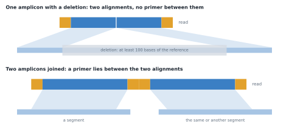

*Figure: Two alignments of a read are one amplicon with a deletion, or two amplicons joined, depending on the primer between them.*

```
UNITS(A)
1  A = the alignments of A with at least 30 aligned read bases,
           ordered along the read as sequenced
2  for each x of A
3      // search primers and controls at both ends of the alignment (→ B4)
       SEARCH_BOUNDARIES(x, x.ref)
4  chains = ⟨⟩
5  for each x of A
6      if chains ≠ ⟨⟩ and JOINED(the last alignment added, x)
7          add x to the last chain
8      else append the new chain ⟨x⟩ to chains
9  return ⟨MAKE_UNIT(c) for each chain c⟩
```

```
JOINED(x, y)
   // x before y in the read oriented as the reference
1  return FALSE if x.ref ≠ y.ref or x.strand ≠ y.strand
2  if y.qs − x.qe − 1 ≥ 8 and (x.right ≠ NIL or y.left ≠ NIL)
3      return FALSE // a primer between them: two amplicons
4  return y.rs ≥ x.re − 30 and y.qs > x.qs and y.qe > x.qe
```

```
MAKE_UNIT(chain)
 1  x = the first alignment of chain, on the reference
 2  y = the last
 3  R = x.ref
 4  u = a new unit; u.blocks = ⟨⟩; u.deletions = ⟨⟩
 5  if x.left ≠ NIL
 6      u.left.q = min(x.left.end + 1, x.qe) // first template base of the read
 7      u.left.pos = REF_OF(x, u.left.q)
 8  else u.left.q = x.qs
 9      u.left.pos = x.rs
10  if u.left.pos ≤ R.first_template + 10
11      u.left.origin = TERMINAL
12  else u.left.origin = INTERNAL
13  set u.right from y in the mirror way, with R.last_template − 10
14  if x.left == NIL and x.left_flank ≠ NIL
15      u.left = the primer of the flank, at the terminus, TERMINAL
16      add the flank as a block, and what lies between it and x.rs as a deletion
17  if y.right == NIL and y.right_flank ≠ NIL
18      the same at the right end
19  prev = NIL
20  for each piece z of chain, alignments being cut at their deletions of ≥ 100 bases
21      if prev ≠ NIL and z.qs ≤ prev.qe and z.rs − prev.re − 1 ≥ 100
22          // read bases that fit both flanks of a deletion: counted once, with z
            shorten the last block of u by prev.qe − z.qs + 1 bases
23      if prev == NIL
24          append (z.rs, z.re) to u.blocks
25      elseif (z.rs − prev.re − 1) − max(0, z.qs − prev.qe − 1) ≥ 100
26          append (prev.re + 1, z.rs − 1) to u.deletions
27          append (z.rs, z.re) to u.blocks
28      else extend the last block of u to z.re // template that did not align
29      prev = z
30  return u
```

```
SHORT_FLANK(x, R, side)
   // a flank too short to be mapped, before a deletion; written for LEFT
1  hp = a whole primer (≤ 20% errors) ending 12 to 60 bases before x.qs,
           the nearest to x.qs
2  return NIL if hp == NIL
3  f = the read bases between hp and x.qs
4  m = FIND(f, R[R.first_template − 8:R.first_template + length(f) + 7], ⌊ length(f) / 5 ⌋)
5  return NIL if m == NIL or x.rs − m.end − 1 < 100
6  return (hp, m.start, m.end)
```

```
CATEGORY(u)
1  return "deletion" if u.deletions ≠ ⟨⟩
2  if u.left has a primer and u.left.origin == INTERNAL
3      return "internal" with the strand of the read
4  if u.right has a primer and u.right.origin == INTERNAL
5      return "internal3"
6  if u.left has a primer
7      return "terminal" with the strand of the read
8  return "noprimer_terminal" if u.left.origin == TERMINAL
9  return "noprimer_fragment"
```

```
JUNCTION_KIND(u, v)
   // two consecutive units of a read
1  if a primer of u or of v faces the junction
2      return "amplicons joined end to end"
3  return "same segment, rearranged" if u.ref == v.ref
4  return "different segments, no primer"
```

A stretch of the read outside all units, of at least 42 bases, which
contains a primer (at most 1 error, either strand) counts as one more
amplicon of the read, which is not influenza.

**Running time and memory.**

Symbols:

- *n*′ length of the read (or part).

*a* is the number of alignments of a read and *q* the number of their
blocks (*q* ≤ *n*′).

| procedure | worst-case time | note | memory | note |
| --- | --- | :-: | --- | :-: |
| JOINED | *O*(1) |  | *O*(1) |  |
| CATEGORY | *O*(1) |  | *O*(1) |  |
| JUNCTION_KIND | *O*(1) |  | *O*(1) |  |
| SHORT_FLANK | *O*(1) | ¹ | *O*(1) |  |
| MAKE_UNIT | *O*(*q*) |  | *O*(*q*) |  |
| UNITS | *O*(*a* log *a* + *an*′) | ² | *O*(*an*′) | ³ |

- ¹ A primer within 60 bases; a flank of at most 60 bases aligned to as
  many of the reference.
- ² Sorting, then SEARCH_BOUNDARIES for each alignment.
- ³ Each alignment carries the read.

## B6. Classification of reads that do not map

The reads that map nowhere are sorted by their primers.
CLASSIFY_UNMAPPED searches a primer within 100 bases of each end (lines
1–2). Two primers with fewer than 30 bases between them are a primer
dimer; two primers with more are an off-target amplicon, in which
something other than influenza was amplified; then come the reads with
one primer and with none (lines 4–8). CLUSTER_OFFTARGET clusters the
off-target amplicons to identify them: templates whose first 24 bases
differ by at most 3 edits go together (lines 2–5), and the 10 largest
groups are reported, each with a typical sequence (lines 6–7).

> **Source:** `classify_unmapped` in `amplicons.py`; `offtarget.py`

```
CLASSIFY_UNMAPPED(read)
1  s = the best primer beginning within 100 bases of the start of read
2  t = the same for RC(read)
3  // as PRIMER_AT, without a boundary: lowest error rate, then the first
   ℓ = the number of bases of read between s and t
4  if s ≠ NIL and t ≠ NIL
5      return "dimer" if ℓ < 30
6      return "offtarget"
7  return "one_primer" if s ≠ NIL or t ≠ NIL
8  return "no_primer"
```

```
CLUSTER_OFFTARGET(S)
   // S: templates of ≥ 24 bases of unmapped reads that begin with the 12 primer
1  centres = ⟨⟩
2  for each distinct key k = t[1:24], t in S, by decreasing frequency
3      if EDIT(k, c) ≤ 3 for some c of centres
4          assign k to the first such c
5      else append k to centres
6  for each of the 10 largest clusters
7      report its share of S and, as representative, the template of median
               length among its reads with both primers
```

**Running time and memory.**

Symbols:

- *n*′ length of the read (or part).

*S* is the number of templates sampled (at most 100 per batch), *D*
that of their distinct keys, and *c* the size of a cluster.

| procedure | worst-case time | note | memory | note |
| --- | --- | :-: | --- | :-: |
| CLASSIFY_UNMAPPED | *Θ*(*n*′) | ¹ | *Θ*(*n*′) |  |
| CLUSTER_OFFTARGET | *O*(*S* + *D* log *D*) | ² | *O*(templates) | ³ |

- ¹ The reverse complement; the searches cover 100 + 13 bases at each end.
- ² Ranking the keys. Then at most 2000 keys against at most 50 centres
  (keys of 24 bases: *O*(1) each), and *O*(*c* log *c*) per cluster for
  the median.
- ³ The total length of the templates sampled.

## B7. Comparison of flucut with the mapping, read by read

What the trimming reports about a read is compared with the amplicons
found by alignment. COMPARE_READ counts whether the read was written at
all (lines 1–4) and whether it was written in as many pieces as it has
amplicons (line 5). If the two numbers agree, each piece is compared
with its amplicon (lines 9–10); if not, it is counted as split
differently (line 11). COMPARE_UNIT compares, at each end, the origin
given by the trimming (terminal, internal, unknown, no primer) with the
one the alignment shows (lines 1–7), and how far apart the two positions
are (lines 8–11); then the category of the read (line 12); and, for a
read in one piece, whether exactly the bases outside the template were
removed (lines 13–16). TRIM_VERDICT classifies that difference: right,
too much (template removed) or too little (primer bases left), with the
special case of the terminus that is meant to be kept (lines 2–8).
ORIGIN_SCORES summarizes the origins as precision (of the ends reported
as internal, the share that are) and recall (of the ends that are
internal, the share reported as such), and the same for terminal; a
primer that only one of the two finds counts as a mistake (lines 1–4).

> **Source:** `flucut_tags.py`; `_agreement` in `summary.py`

```
COMPARE_READ(parts, layout, lift)
    // parts: the records flucut wrote for the read; layout: its amplicons from B5
    // written, split, category: tables of counts of the sample, set to zero in POSTHOC (B1)
 1  if parts == NIL
 2      INC(written["not written", kind of the read])
 3      return
 4  INC(written["written", kind of the read])
 5  INC(split[length(parts), length(layout)])
 6  for i = 1 to length(parts)
 7      p = parts[i], its positions moved to the chosen references by lift
 8      c = the category flucut gives p in its coverage analysis // as COVER, from the tags
 9      if length(parts) == length(layout) and layout[i] is a unit
10          COMPARE_UNIT(p, c, layout[i], length(parts) == 1)
11      else INC(category[c, "split differently", "not influenza" or the unmapped kind])
```

```
COMPARE_UNIT(p, c, u, single)
    // origin, position, category, trim: tables of counts of the sample (B1)
 1  for each (end, primer) in ⟨(left, Uni12), (right, Uni13)⟩
 2      if p has a primer at end
 3          said = the origin flucut gave it // terminal, internal, unknown
 4      else said = "no primer"
 5      x = the end of u that carries primer
 6      truth = "no primer" if x == NIL else x.origin
 7      INC(origin[end, said, truth])
 8      if x ≠ NIL and p has a position m at end
 9          if m.ref ≠ u.ref
10              INC(position[end, "other reference"])
11          else INC(position[end, BUCKET(|m.pos − x.pos|)]) // 0, 1–2, 3–5, 6–20, >20
12  INC(category[c, CATEGORY(u)]) // coverage category of the amplicon (→ B5)
13  if single
14      for each end x of u with a primer
15          Δ = bases flucut removed at that read end − bases outside the template there
16          INC(trim[x.origin, TRIM_VERDICT(x, Δ)])
```

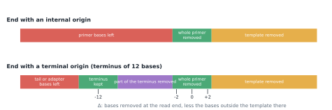

*Figure: The verdict on the trimming of an end, by Δ.*

```
TRIM_VERDICT(x, Δ)
1  τ = length of the terminus of the primer of x
2  return "whole primer removed" if |Δ| ≤ 2
3  return "template removed" if Δ > 2
4  if x.origin == TERMINAL
5      return "terminus kept" if |Δ + τ| ≤ 2
6      return "part of the terminus removed" if Δ > −τ
7      return "tail or adapter bases left"
8  return "primer bases left"
```

```
ORIGIN_SCORES(origin, end)
   // XY = origin[end, X, Y]: flucut said X, the mapping shows Y
   // T terminal, I internal, U unknown, N no primer
1  internal_precision = II / (II + IT + IN) // IN: a primer only flucut finds
2  internal_recall = II / (II + TI + UI + NI) // NI: a primer flucut misses
3  terminal_precision = TT / (TT + TI + TN)
4  terminal_recall = TT / (TT + IT + UT + NT)
5  return (internal_precision, internal_recall, terminal_precision, terminal_recall)
```

**Running time and memory.**

*x* is the number of parts of a read written by flucut.

| procedure | time | note | memory | note |
| --- | --- | :-: | --- | :-: |
| TRIM_VERDICT | *O*(1) |  | *O*(1) |  |
| ORIGIN_SCORES | *O*(1) |  | *O*(1) |  |
| COMPARE_UNIT | *O*(1) |  | *O*(1) |  |
| COMPARE_READ | *O*(*x*) | ¹ | *O*(*x*) | ² |

- ¹ Plus the length of the tags, which are parsed.
- ² The tables of counts have a fixed size.

## B8. Comparison of sites, lengths and coverage profiles

Three summaries of the trimming are compared with the same quantities
measured from the alignments. COMPARE_SITES, the internal priming sites:
the measured starts are merged into sites as in A15 (line 1); each site
is described by the bases of the reference under the primer and by where
they differ from it (lines 4–5), and matched with the reads that the
trimming reports within 5 bases (line 6); the sites that only the
trimming reports are listed (lines 7–8). COMPARE_LENGTHS: the histogram
of the lengths of the amplicons with both primers, and how many are
short (lines 3–6). COMPARE_COVERAGE: the depth along the reference from
the alignments and from the report of the trimming (lines 1–3), compared
by their means, their Pearson correlation and their mean difference
(line 4).

> **Source:** `summary.py`, `flucut_report.py`, `pipeline.py`

```
COMPARE_SITES(measured_ends, flucut_ends)
   // both: reads per (reference, side, position) of internal ends with a primer
1  M = positions of measured_ends, merged into sites when ≤ 5 apart
2  for each site s of M
3      s.position = its position with most reads
4      s.footprint = the bases of the reference under the terminus of the primer at s
5      s.mismatches = positions at which s.footprint differs from the terminus
6      s.flucut_reads = reads of flucut_ends within 5 bases of s
7  F = positions of flucut_ends, merged in the same way
8  only_flucut = the sites of F with no site of M within 5 bases
9  return M sorted by decreasing reads, only_flucut
```

```
COMPARE_LENGTHS(R)
1  hist = [0, 0, 0, ...] // 401 bins of 10 bases
2  short = 0
3  for each unit u on R with a Uni12 primer on the left and a Uni13 primer on the right
4      ℓ = template length of u
5      INC(hist[⌊ min(ℓ, 4000) / 10 ⌋])
6      INC(short) if ℓ < 90% · length(R)
7  report hist, short and the fullest bin beside those of flucut (A16)
```

```
COMPARE_COVERAGE(R)
1  for each position x of R
2      a[x] = the number of unit blocks covering x, over all categories
3      b[x] = the depth flucut shows at x, over all categories
4  // b is read from the plots of flucut's HTML report: depth = polygon height
   // / plot height · axis maximum, at up to 704 positions, interpolated, and moved
   // to R by lift; without the report it is rebuilt from the tags as in A17
   return mean(a), mean(b), PEARSON(a, b), mean over x of |a[x] − b[x]|
```

**Running time and memory.**

Symbols:
- *m*′ length of one reference;
- *m* total length of the references.

*S*<sub>M</sub> and *S*<sub>F</sub> are the numbers of distinct end
positions measured and reported by flucut (each at most 2*m*).

| procedure | worst case | note | typical | note | memory | note |
| --- | --- | :-: | --- | :-: | --- | :-: |
| COMPARE_SITES | *O*(*S*<sub>M</sub> *S*<sub>F</sub>) | ¹ | negligible | ² | *O*(*S*<sub>M</sub> + *S*<sub>F</sub>) |  |
| COMPARE_LENGTHS | *O*(1) | ³ |  |  | *O*(1) | ³ |
| COMPARE_COVERAGE | *Θ*(*m*′) | ⁴ |  |  | *Θ*(*m*′) |  |

- ¹ Every measured site is compared with every position of flucut on
  its reference and side. Sorting and merging first:
  *O*(*S*<sub>M</sub> log *S*<sub>M</sub> + *S*<sub>F</sub> log *S*<sub>F</sub>).
- ² A few hundred sites.
- ³ Per unit, and per reference.
- ⁴ The depths and the correlation; *O*(1) per block added before that.

## B9. Comparison of IRMA with the mapping

IRMA is the assembler that usually follows the trimming. COMPARE_IRMA
notes for each read what it is (lines 1–5) and whether IRMA used it in
an assembly, and for the right segment (lines 6–9). LIFT_CONSENSUS
examines the consensus that IRMA built: aligned to the reference (line
1) it gives the depth along the reference (lines 2–3), and shows the
deletions of at least 100 bases (line 4) and the primers inside the
consensus (line 5).

> **Source:** `irma.py`; `process_batch` in `analysis.py`

```
COMPARE_IRMA(r, U, runs)
   // irma, same_segment: tables of counts of the sample (B1)
1  if U == ⟨⟩
2      truth = the unmapped kind of r
3  elseif length(U) == 1
4      truth = CATEGORY(U[1]) // coverage category of the amplicon (→ B5)
5  else truth = "several"
6  for each run
7      used = the segment of the IRMA assembly that contains r, or NIL
8      INC(irma[run, truth, used ≠ NIL])
9      INC(same_segment[run, some unit of U is on segment used]) if used ≠ NIL and U ≠ ⟨⟩
```

```
LIFT_CONSENSUS(c, R, depth)
   // c: the consensus IRMA built for the segment of R; depth: along c
1  align c to R // minimap2 -c, the options of B3
2  for each aligned pair (i in c, x in R)
3      depth_on_R[x] = depth[i]
4  deletions = the gaps between consecutive aligned pieces in which R has
           at least 100 bases more than c
5  inside = the primer matches (≤ 1 error, either strand) ending more than
           30 bases from both ends of c
6  return depth_on_R, deletions, inside
```

A deletion or a primer inside a consensus shows that it was built from
deleted genomes, or from amplicons joined end to end.

**Running time and memory.**

Symbols:
- *N* reads in the readset;
- *m*′ length of one reference.

| procedure | time | note | memory | note |
| --- | --- | :-: | --- | :-: |
| COMPARE_IRMA | *O*(runs · units) | ¹ | *O*(*N*) per run | ² |
| LIFT_CONSENSUS | alignment + *O*(*m*′) | ³ | *Θ*(*m*′) |  |

- ¹ Of the read; look-ups by read name take expected *O*(1).
- ² The names of the reads IRMA assembled.
- ³ One alignment of the consensus; the primers inside are searched in
  *O*(*m*′).

---

# C. Benchmark

Part C measures the trimming where the right answer is known. The
artefact in question: a primer that binds at an internal site writes its
own bases into the reads that start there; at the Uni12-like site of HA
the codon ATA (isoleucine) is read as AAA (lysine).

- Reads are simulated with a label for every base (C1), so that the
  bases wrongly removed or kept by each tool are counted exactly (C2).
- The consensus assembled from the trimmed reads is compared with the
  true segment (C3), also at low depth, where the artefact has its
  largest effect (C4).
- In real and public data the artefact is followed at its codon: in
  mapped reads, by where the read starts (C5); in the consensus from
  trimmed and untrimmed reads (C6); and in database records and raw
  reads (C7).

Source: `benchmark/`. Results: `benchmark/RESULTS.md`.

## C1. Simulation of reads in which the origin of every base is known

To measure the accuracy of a trimming tool exactly, reads are simulated
in which the origin of every base is known. BEST_SITE finds the place
inside the HA segment that most resembles Uni12, where the primer could
bind by mistake (lines 2–4). SIMULATE builds amplicons: primer, segment,
primer (line 8) or, for a share of the HA amplicons, starting at the
internal site, where the bases of the primer replace those of the
segment (lines 6–7). It adds what real libraries have: primer dimers
(line 9), amplicons that lack bases at an end or are broken (lines
10–16), adapters (line 17), either strand (line 18), random flanks (line
19), and sequencing errors at a rate drawn for each read (lines 20–22).
Each base is written with a label that says what it is (line 23).

> **Source:** `simulate.py`

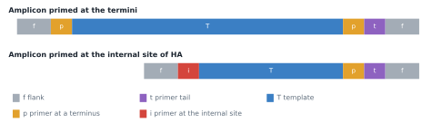

*Figure: Each base of a simulated read carries the label of its origin.*

```
SIMULATE(genome, reads_per_segment, internal_share, μ)
 1  site = BEST_SITE(Uni12, HA)
 2  for each segment S of genome
 3      for k = 1 to reads_per_segment
 4          p12 = Uni12 with its R drawn as A or G
 5          p13 = RC(tail + Uni13)
 6          if S == HA and RANDOM(0, 1) < internal_share
 7              amp = p12 + S[site + 12:length(S) − 13] + p13 // labels i, T, p t
 8          else amp = p12 + S[13:length(S) − 13] + p13 // labels p, T, p t
 9              amp = p12 + p13 if RANDOM(0, 1) < 0.01 // primer dimer
10          u = RANDOM(0, 1)
11          if u < 0.10
12              remove the first 1 to 8 bases of amp
13          elseif u < 0.20
14              remove the last 1 to 15 bases of amp
15          elseif u < 0.25 and amp is not a dimer
16              break amp at a point of its middle half; keep one piece
17          amp = adapter + amp + RC(adapter) if barcodes are simulated // label f
18          amp = RC(amp) if RANDOM(0, 1) < 0.5
19          add 0 to 40 random bases at each end of amp // label f
20          ρ = a draw from Normal(μ, μ / 2), limited to [0.005, max(0.15, 3μ)]
21          for each base of amp
22              substitute it with probability 0.4ρ, insert a base before it
                        with probability 0.3ρ, delete it with probability 0.3ρ
23          write amp, and for each of its bases its label
```

```
BEST_SITE(primer, seq)
1  n = length(primer)
2  for i = 51 to length(seq) − n − 49 // not in the first or last 50 bases
3      d[i] = positions j at which primer[j] does not match seq[i + j − 1]
4  return argmin(d) // it must be unique
```

Labels: `f` flank, `t` primer tail, `p` primer at a terminus, `i`
primer at the internal site, `T` template. The bases under a primer
come from the primer, not from the segment.

**Running time and memory.**

Symbols:
- *m*′ length of one reference;
- *m* total length of the references.

*ℓ* = 12 is the length of Uni12 and *k* the number of reads per segment.

| procedure | time | note | memory | note |
| --- | --- | :-: | --- | :-: |
| BEST_SITE | *Θ*(*ℓm*′) |  | *Θ*(*m*′) |  |
| SIMULATE | *Θ*(*km*) | ¹ | *O*(*m*′) | ² |

- ¹ The bases written; plus *Θ*(*ℓm*′) for BEST_SITE.
- ² One read at a time.

## C2. Evaluation of trimmed reads by the known origin of their bases

The output of each tool is compared with the labels. SCORE_READS finds
each trimmed read in its original read (lines 4–5), which gives the
labels of the bases kept (line 8), and counts the two kinds of mistake:
template bases removed (line 9), and bases kept that should have been
removed, i.e. primer, flank and, above all, primer at the internal site,
which carries the artefact (lines 10–12). Reads of which nothing is left
are counted as well (line 13).

> **Source:** `score_reads.py`, `run-tools.sh`

```
SCORE_READS(inputs, labels, outputs)
 1  not_found = 0; template_removed = 0
 2  primer_kept = 0; flank_kept = 0; internal_kept = 0
 3  for each read o of outputs
 4      r = the input read of o // by name; <name>_<k> for a piece
 5      find o in r as an exact substring, on either strand, at r[i:j]
 6      if it is not found
 7          INC(not_found)
 8      else kept = labels[r][i:j]
 9          INC(template_removed, the number of T in labels[r] outside i:j)
10          INC(primer_kept, the number of p and t in kept)
11          INC(flank_kept, the number of f in kept)
12          INC(internal_kept, the number of i in kept) // the bases that carry the artefact
13  reads_lost = the reads with template bases of which nothing was written
14  return (reads_lost, template_removed, primer_kept, flank_kept, internal_kept, not_found)
```

The same reads go through every tool compared (flucut, cutadapt, the
IRMA-core trimmer, BBDuk, Porechop_ABI, dorado trim, minimap2 with
samtools ampliconclip, Barbell), each given the same primer sequences.

**Running time and memory.**

Symbols:
- *n*′ length of the read (or part);
- *n* total bases of those reads.

| procedure | worst case | note | typical | note | memory | note |
| --- | --- | :-: | --- | :-: | --- | :-: |
| SCORE_READS | *O*(*n*′²) per read | ¹ | *O*(*n*) in all | ² | *Θ*(*n*) | ³ |

- ¹ The exact substring search.
- ² *O*(*n*′) per read.
- ³ All input reads and their labels are held.

## C3. Comparison of a consensus with the true sequence

The result that counts is the consensus sequence assembled from the
trimmed reads. COMPARE_CONSENSUS aligns it to the true segment (line 1)
and counts the bases missing or extra at the two ends (lines 2–4), the
substitutions, insertions, deletions and ambiguous bases (lines 6–16)
and, separately, the differences at the internal priming site, where the
artefact would show (line 17).

> **Source:** `compare_consensus.py`, `run-irma-checks.sh`

```
COMPARE_CONSENSUS(c, S, site)
    // c: the consensus of IRMA for segment S; N in c matches any base
 1  align the whole of c to a substring S[i:j] with the fewest edits
 2  missing_5 = i − 1
 3  missing_3 = length(S) − j
 4  extra_5, extra_3 = bases of c aligned to nothing at the two ends
 5  subst = 0; ins = 0; del = 0; ambiguous = 0; n_bases = 0; site_errors = 0
 6  for each column of the alignment between them
 7      if it is a base of S without a base of c
 8          INC(del)
 9      elseif it is a base of c without a base of S
10          INC(ins)
11      elseif the base of c is N
12          INC(n_bases)
13      elseif the base of c is another ambiguity code
14          INC(ambiguous)
15      elseif the two bases differ
16          INC(subst)
17      INC(site_errors) if the column is a difference within the 12 bases of site
18  return (missing_5, missing_3, extra_5, extra_3, subst, ins, del,
            ambiguous, n_bases, site_errors)
```

**Running time and memory.**

Symbols:
- *m*′ length of one reference;
- *w* machine word (64 bits).

*d* is the edit distance between the consensus and the segment.

| procedure | worst case | note | typical | note | memory | note |
| --- | --- | :-: | --- | :-: | --- | :-: |
| COMPARE_CONSENSUS | *O*(*m*′²/*w*) | ¹ | *O*(*dm*′/*w*) | ² | *O*(*dm*′/*w*) | ³ |

- ¹ The bit-parallel alignment; the columns are then read in *O*(*m*′).
- ² The alignment is banded on *d*, which is small for a consensus.
- ³ The alignment path; edlib bounds it by divide and conquer for large
  tables.

## C4. Effect of the artefact at low sequencing depth

The artefact has its largest effect where few reads cover a position.
LOW_DEPTH simulates samples with 10, 20 and 40 reads per segment, three
times each, with 60% of the HA reads internally primed (lines 1–3),
trims them with each tool (line 4), assembles them with IRMA (line 5)
and compares each consensus with the true sequence (lines 6–8).

> **Source:** `run-coverage.sh`

```
LOW_DEPTH(genome)
1  for each n in ⟨10, 20, 40⟩
2      for seed = 1 to 3
3          // simulate reads with the origin of each base (→ C1)
           reads = SIMULATE(genome, n, 0.6, 0.04) with this seed
4          for each tool in ⟨untrimmed, flucut, cutadapt, IRMA-core⟩
5              c = IRMA FLU-minion on the reads trimmed by tool
6              for each segment S of genome that c holds
7                  // count the differences of the consensus from the true segment (→ C3)
                   d[S] = COMPARE_CONSENSUS(c[S], S, the internal site if S is HA)
8              report the segments assembled; the sums over them of the counts of d:
                       subst + ins + del, ambiguous, site_errors, n_bases;
                       and the codon at the site in c[HA]
```

**Running time and memory.**

LOW_DEPTH is 9 simulations (C1), each trimmed by 4 tools, assembled by
IRMA and compared (C3): its cost is that of the 36 assemblies.

## C5. Codon at the internal priming site in real reads, by read start position

In real data the true sequence is not known, but the start position of a
read tells whether the codon at the internal priming site can come from
the primer. A read that begins upstream of the site was copied through
it from the template, and shows the codon of the virus. A read that
begins at the site may have been primed there: its first bases, the
codon among them, are then those of the primer. CODON_BY_START takes the
primary alignments that cover the codon (line 3), assigns each to a
class by its start position (lines 5–9) and counts the codons observed
in each class (line 10). The artefact appears as `AAA` in the reads that
start at the site, against `ATA` in those that start upstream.

> **Source:** `site_reads.py`, `run-real-nanopore.sh`,
> `run-real-illumina.sh`

```
CODON_BY_START(alignments, site)
    // site: first of the 12 Uni12-like bases of the HA of the isolate
 1  codon = site + 4 // ATA in the template, AAA in the primer
 2  count = [0, 0, 0, ...] // for each class and codon
 3  for each primary alignment x that covers codon:codon + 2 with read bases
 4      b = the read bases aligned to codon:codon + 2
 5      if x.rs ≤ site − 10
 6          class = "upstream" // the amplicon began before the site
 7      elseif |x.rs − site| ≤ 3
 8          class = "at_site" // possibly primed at the site
 9      else class = "other"
10      INC(count[class, b])
11  return count
```

Reads that start upstream show the template; reads that start at the
site can carry the primer.

**Running time and memory.**

| procedure | time | note | memory | note |
| --- | --- | :-: | --- | :-: |
| CODON_BY_START | *O*(aligned length) | ¹ | *O*(codons) | ² |

- ¹ Per alignment over the codon; only those are read (indexed BAM).
- ² The distinct codons seen.

## C6. Comparison of the consensus sequences from trimmed and untrimmed reads

COMPARE_TO_UNTRIMMED tests whether trimming changes the result on real
data. IRMA is run on the untrimmed reads (line 1) and on the reads
trimmed by each tool (line 3); the differences between the two consensus
sequences are counted for each segment (line 5), and the codon at the
site is read from the HA consensus (lines 6–7).

> **Source:** `run-real-nanopore.sh`

```
COMPARE_TO_UNTRIMMED(run, tools, site)
1  base = the consensus of IRMA from the untrimmed reads, per segment
2  for each tool
3      c = the consensus of IRMA from the reads trimmed by tool
4      for each segment g
5          differences[tool, g] = EDIT(c[g], base[g])
6      i = the position in c[HA] of the 10 bases that precede site in base[HA]
7      codon[tool] = c[HA][i + 14:i + 16]
8  return (differences, codon)
```

**Running time and memory.**

Symbols:
- *m*′ length of one reference;
- *w* machine word (64 bits).

*d* is the edit distance between the two consensus sequences, here a
few bases.

| procedure | worst case | note | typical | memory |
| --- | --- | :-: | --- | --- |
| COMPARE_TO_UNTRIMMED | *O*(*m*′²/*w*) | ¹ | *O*(*dm*′/*w*) | *O*(*m*′) |

- ¹ Per segment and tool.

## C7. Search for the artefact in database records and raw reads

Two scans are made without mapping. SCAN_RECORDS looks in public H5N1 HA
sequences for the protein motif around the site and reports the amino
acid at the affected position: I is the virus, K the artefact of the
primer (lines 1–4). CODON_IN_RAW_READS does the same in raw reads: it
finds the 12 bases that follow the site (line 4), reads the codon just
before them (line 6) and classes the read by whether the site is at its
start, where internal priming is possible, or well inside it, where the
read spans the site (lines 7–9).

> **Source:** `notes/real_data_scans/`

```
SCAN_RECORDS(records)
   // all GenBank H5N1 HA records of 1600 to 2000 nt
1  for each record
2      for each of its 6 reading frames
3          for each match of the peptide GLFGA·AG in the translation
4              report the residue at · // I template, K artefact
```

```
CODON_IN_RAW_READS(reads, HA, site)
    // without mapping
 1  flank = HA[site + 12:site + 23] // the 12 template bases after the site
 2  count = [0, 0, 0, ...] // for each class and codon
 3  for each read, on both strands
 4      j = the first exact occurrence of flank
 5      if j > 12
 6          b = read[j − 8:j − 6] // bases 5 to 7 of the site
 7          if j − 12 ≤ 61
 8              class = "site near the read start" // possible internal priming
 9          else class = "site inside the read" // the read spans it: template
10          INC(count[class, b])
11  return count
```

**Running time and memory.**

Symbols:
- *n*′ length of the read (or part);
- *n* total bases of those reads;
- *m*′ length of one reference.

| procedure | worst case | note | typical | memory |
| --- | --- | :-: | --- | --- |
| SCAN_RECORDS | *Θ*(*m*′) per record | ¹ |  | *Θ*(*m*′) |
| CODON_IN_RAW_READS | *O*(*n*′) per read | ² | *O*(*n*) in all | *O*(*n*′) |

- ¹ Six translations and a pattern search.
- ² With a constant up to 12 (the length of the flank searched), on each
  strand.

---

# D. Appendix: secondary procedures

Procedures that the main algorithms call but that decide nothing about
a read: bookkeeping and small helpers.

## D1. K-mer index of the references

The k-mer index gives, for each possible k-mer (a word of k = 10 bases),
where it occurs in the references. BUILD_INDEX counts each k-mer (lines
1–4), reserves room for its occurrences (lines 5–7) and fills them in
(lines 10–15). DIAGONALS looks up every k-mer of a probe (lines 3–8) and
turns each occurrence into a diagonal: the position in the reference
less the position in the probe, which is where the probe would begin if
that k-mer is in place (line 9). A k-mer that occurs more than 4096
times is not informative and is not used as a seed (line 6). Several
seeds on the same diagonal mean that the probe probably lies there.

> **Source:** `ext/libcbaia/src/seq/kmer-index.c`

> **Called from:** FLUCUT_RUN (A1), which builds the index, and LOCATE
> (A10), which reads it

`CODE(s)` is the number of a k-mer `s` made of A, C, G and T only: two
bits per base, from 0 to 4^k − 1. A k-mer with another character (an N,
a degenerate base) has no code and is skipped.

```
BUILD_INDEX(refs)
    // the occurrences of each k-mer in the references, grouped by k-mer
    k = 10
 1  count = [0, 0, 0, ...] // for each code, 0 to 4^k − 1
 2  for each reference R of refs
 3      for i = 1 to length(R) − k + 1
 4          INC(count[CODE(R[i:i + k − 1])]) if R[i:i + k − 1] has a code
 5  // start[c]: where the occurrences of the k-mer with code c begin in occ
    start[0] = 1
 6  for c = 1 to 4^k
 7      start[c] = start[c − 1] + count[c − 1]
 8  next = a copy of start
 9  occ = [NIL, NIL, ...] // one entry per k-mer occurrence: start[4^k] − 1 in all
10  for each reference R of refs
11      for i = 1 to length(R) − k + 1
12          if R[i:i + k − 1] has a code
13              c = CODE(R[i:i + k − 1])
14              occ[next[c]] = (R, i)
15              INC(next[c])
16  return (start, occ)
```

```
DIAGONALS(index, x)
    // where the k-mers of the sequence x occur in the references, as diagonals:
    // a diagonal is the position in the reference less the position in x
 1  (start, occ) = index
 2  H = ⟨⟩
 3  for j = 1 to length(x) − k + 1
 4      if x[j:j + k − 1] has a code
 5          c = CODE(x[j:j + k − 1])
 6          // a k-mer that occurs more than 4096 times is not used as a seed
            if start[c + 1] − start[c] ≤ 4096
 7              for t = start[c] to start[c + 1] − 1
 8                  (R, i) = occ[t]
 9                  append (R, i − j) to H
10  return H sorted by reference, then by diagonal, without repeats
```

**Running time and memory.**

Symbols:

- *m* total length of the references;
- *P* probe length (32);
- *h* 10-mer seed hits of a probe.

| procedure | time | note | memory | note |
| --- | --- | :-: | --- | :-: |
| BUILD_INDEX | *Θ*(*m*) | ¹ | *Θ*(*m*) | ¹ |
| DIAGONALS | *O*(*P* + *h* log *h*) | ² | *O*(*h*) | |

- ¹ Two passes over the references. Plus the fixed tables `count`,
  `start` and `next`, of 4^10 ≈ 10^6 entries each.
- ² For a probe: one look-up per k-mer, then the sort of the hits.

## D2. Counters of a readset

INIT_COUNTS sets all counts of a sample to zero and prepares the arrays
that hold one count per reference position (lines 1–6). UPDATE_COUNTS
adds one analysed part of a read: reads and bases in and out (lines
1–5), how many primers were found (lines 6–7), strand, dimers, matches
inside and adapters (lines 8–12), the origin and the primer of each end
(lines 13–15), and the three summaries kept per position or length:
sites, lengths and coverage profiles (lines 16–18). Line 19 counts the
reads the references place on a segment.

> **Source:** `src/analysis/counter.c`

> **Called from:** FLUCUT_RUN (A1)

```
INIT_COUNTS(rs)
   // sets the statistics of the readset rs to zero, before its first read
1  set every counter of rs to 0: reads_in, bases_in, reads_out, bases_out, too_short,
           primers_found[0:2], minus_strand, dimers, with_internal, adapter_start,
           adapter_end, placed, origin[side, origin], primer_used[side, primer]
2  if refs ≠ NIL
3      for each reference R of refs
4          // starts of internally primed ends, per position
           let rs.starts[R, side, 1:length(R)] be zeros
5          // spans begun and ended, per position and category c
           let rs.begins[R, c, 1:length(R)], rs.ends[R, c, 1:length(R)] be zeros
6  // template lengths of complete amplicons, bins of 10
   let rs.hist[k, 0:400] be zeros, for each reference k and NOT_LOCATED
```

```
UPDATE_COUNTS(rs, a, part, keep)
    // adds the analysis a of a part of a read to the statistics of its readset rs
    // keep: whether the part is written (enough of it is left after trimming)
    // INC(c) adds 1 to the counter c; INC(c, v) adds v
 1  // counters of rs (one number each)
    INC(rs.reads_in)
 2  INC(rs.bases_in, length(part))
 3  INC(rs.reads_out)                      if keep
 4  INC(rs.bases_out, a.to − a.from + 1)   if keep
 5  INC(rs.too_short)                      if not keep
 6  k = number of ends of a with a primer // 0, 1 or 2
 7  INC(rs.primers_found[k])
 8  INC(rs.minus_strand)   if a.strand == "−"
 9  // both primers, nothing between them
    INC(rs.dimers)         if k == 2 and a.to < a.from
10  // primer-like matches inside the read
    INC(rs.with_internal)  if a.internal ≠ ⟨⟩
11  // adapter removed at the read start, at the read end
    INC(rs.adapter_start)  if a.adapter_start ≠ NIL
12  INC(rs.adapter_end)    if a.adapter_end ≠ NIL
13  for each x in ⟨a.left, a.right⟩ with x ≠ NIL
14      // origin of the end (terminal, internal, unknown) and primer of the scheme found there
        INC(rs.origin[x.side, x.origin])
15      INC(rs.primer_used[x.side, x.primer])
16  COUNT_SITE(rs, a) // count where internally primed ends start (→ A15)
17  // add template length of a complete amplicon to its histogram (→ A16)
    COUNT_LENGTH(rs, a)
18  // add span of the read to the coverage profile of its category (→ A17)
    COVER(rs, a)           if refs ≠ NIL
19  // reads the references place on a segment: COVER drew a span for them
    INC(rs.placed)         if refs ≠ NIL and COVER drew the read
```

Their running time and memory are given with FLUCUT_RUN, in A1.

## D3. Outputs of a readset

WRITE_RECORD writes the kept part of a read, with tags that describe
what was found in it (lines 1–4). WRITE_REPORTS writes the counts of the
sample (line 1), its internal priming sites (line 2) and its short
amplicons (line 4), turns the counts per position into depths (lines
5–7) and writes the tables and the report (lines 8–9).

> **Source:** `src/seq/trimmer.c`, `src/io/results.c`, `src/reports/report.c`

> **Called from:** FLUCUT_RUN (A1)

```
WRITE_RECORD(out, part, a)
    // appends the kept bases of a part of a read to the FASTQ output out
1  title = part.name + TAGS(a)
2  seq = part.seq[a.from:a.to]
3  qual = part.qual[a.from:a.to]
4  append the record (title, seq, qual) to out
```

`TAGS(a)` are the SAM-style tags that describe the analysis: `fs`
strand; `fl`, `fr` primer found at each end; `tl`, `tr` bases removed at
the start and at the end; `ni` primer-like matches inside; `a5`, `a3`
adapter kit removed; `ol`, `or` origin of each end; `ml`, `mr` where its
probe mapped (reference:position:strand); `ct` the category of the read
(full template, internal priming, internal deletion, not placed, other);
`sp` part k/n of a split read. The sequence and its orientation are not changed.

```
WRITE_REPORTS(rs)
    // writes what was counted for the readset rs
1  append the counters of rs to summary.tsv, as one line
2  // internal priming sites, by decreasing number of reads (→ A15)
   S = SITES(rs)
3  for each reference R of refs
4      // complete amplicons shorter than 90% of R (→ A16)
       short[R] = SHORT_COMPLETE(rs, R)
5      for each coverage category c
6          for x = 1 to length(R)
7              depth[R, c, x] = depth[R, c, x − 1] + rs.begins[R, c, x] − rs.ends[R, c, x − 1]
8  append the length histograms rs.hist to lengths.tsv
9  write S, short, rs.hist and depth to the HTML report and the JSON summary
```

In line 7, `depth[R, c, 0]` and `rs.ends[R, c, 0]` are 0: the depth at
`x` is the number of spans begun at or before `x` less the number ended
before it (A17). Without references, lines 3–7 are skipped and the
peaks of the length histogram are reported instead (PEAKS, A16).

Left and right in the tags are those of the amplicon; for a read of the
minus strand the left end is at the end of the read. `--no-tags` leaves
the tags out.

| file | content |
|---|---|
| `<sample>.fastq.gz` | trimmed reads, original order and orientation, tags in the title |
| `summary.tsv` | one line per sample: the counters of D2 |
| `lengths.tsv` | histograms of complete-amplicon lengths |
| `flucut_report.html` | self-contained report (inline SVG, no scripts): parameters, the sample (subtype, reads of a second HA or NA subtype, segments), reads at each step, primers, internal priming sites, complete amplicons, length histograms, coverage plots by read origin |
| `flucut_summary.json` | the same content, versioned format |

Reports are written to a temporary file and renamed, so that a partial
report is never read.

### The sample, segment by segment

`src/analysis/qc-summary.c`. From the same counts, a summary of the sample is
shown first in the report of each readset. For each of the eight
segments, the reference with the greatest depth among those of the
segment gives:

| measure | definition |
|---|---|
| reference, subtype | its accession, and the subtype (H and N numbers) named in its description |
| mean depth | reads per position, over all coverage categories |
| covered | share of its positions with at least 1 read |
| depth ≥ 50 | share of its positions with at least 50 reads (the support FLU-minion of IRMA needs for a base of its amended consensus) |
| internally primed | share of the depth in the two internal categories |
| internal deletion | share of the depth in the deletion category |
| complete amplicons, short | amplicons with both primers; of them, the share shorter than 90% of the reference |

The sample also carries short remarks on what deserves attention: fewer
than 1000 reads, no primer in 20% or more of the reads, half or more of
the read ends not located, a segment with 10% or more of its depth
internally primed or 50% or more from reads with an internal deletion, a
cleavage site the reads do not settle, and fewer than 30% of the reads
placed on a segment. The last one says that the references describe
little of the sample: its segments, coverage and subtype rest on the few
reads that were placed. It is shown as a problem, tinted, both as the
remark and in a column of the run overview with the share of the reads
placed. In the 104 Nanopore samples of the HA I351K validation the share
has median 99.2% and is 63% or more in 102 samples; the other two, at
1.4% and 15%, are the two whose reads map to influenza at 1.3% and 15%.
The threshold of 30% lies about halfway between them on a logarithmic
scale.

The subtype of the sample is the H of the reference of its HA and the N
of the reference of its NA. If the references of the segments found
name different subtypes, this is reported: a reassortant, or genes which
differ little between subtypes. A segment without located reads is
reported as not found.

**Running time and memory.**

Symbols:
- *n*′ length of the read (or part);
- *m* total length of the references.

| procedure | time | memory |
| --- | --- | --- |
| WRITE_RECORD | *O*(*n*′) | *O*(*n*′) |
| WRITE_REPORTS | *Θ*(*m*) | *Θ*(*m*) |

## D4. Choice between two candidates

Three steps choose between two candidates; their rules are collected
here. The orientation of a read: more primers, then fewer errors
(MINUS_IS_BETTER lines 1–3). The primer at a read end: the one nearest
the end, then fewer errors, then the longer (BETTER lines 1–7). The
location of a probe: fewer errors; of two equally good ones the nearer
to the end of the segment, and if they are on different references the
hit is marked ambiguous (BETTER_HIT lines 2–6).

> **Source:** `analyze`, `better_hit` in `src/seq/reads/amplicon.c`;
> `align_window` in `src/seq/references/reference.c`

> **Called from:** ANALYSE_ENDS (A5), BEST_PRIMER (A6) and LOCATE
> (A10)

Between the layouts found on the two strands of a read:

```
MINUS_IS_BETTER(minus, plus)
1  if N_PRIMERS(minus) ≠ N_PRIMERS(plus)
2      return N_PRIMERS(minus) > N_PRIMERS(plus)
3  return TOTAL_ERRORS(minus) < TOTAL_ERRORS(plus) // at a tie: plus
```

Between two primer hits at the same end of a read:

```
BETTER(hp, b, side)
1  if side == LEFT and hp.end ≠ b.end
2      return hp.end < b.end // the outermost
3  if side == RIGHT and hp.start ≠ b.start
4      return hp.start > b.start
5  if hp.errors ≠ b.errors
6      return hp.errors < b.errors
7  return hp.end − hp.start > b.end − b.start // the longer
```

Between two locations of a probe in the references:

```
BETTER_HIT(b, hr)
1  return b if hr == NIL
2  return hr if b == NIL or hr.errors < b.errors
3  if hr.errors == b.errors
4      // as good as b: on another reference, the probe does not tell the two apart
       ambiguous = b.ambiguous or hr.ref ≠ b.ref
5      b = hr if TERMINUS_DISTANCE(hr) < TERMINUS_DISTANCE(b)
6      b.ambiguous = ambiguous
7  return b
```

Their running time and memory are given in A5, A6 and A10.

## D5. Distance of a reference hit from its terminus

How many bases lie between the location of a probe and the end of the
segment from which its read would have started (line 1).

> **Source:** `terminus_distance` in `src/seq/references/reference.c`

> **Called from:** BETTER_HIT (D4), ORIGIN (A9) and COVER (A17)

```
TERMINUS_DISTANCE(hr)
1  return hr.pos − 1 if hr.strand == "+" else length(hr.ref) − hr.pos
```

The terminus is the end of the segment from which a read with this hit
would start: the first base for a hit on the plus strand, the last for
one on the minus strand. Its running time and memory are given in A10.

## D6. Helpers of the coverage analysis

ORIGIN_BY_DISTANCE gives the origin of a read from how far its 5′ end
lies from the end of the segment (lines 1–3). ADD_SPAN records a span,
clipped to the reference (lines 1–2), by adding 1 where it begins and 1
where it ends (lines 4–5): the depth is later a prefix sum, and no read
needs to be stored.

> **Source:** `count_cover`, `add_span` in `src/analysis/counter.c`

> **Called from:** COVER (A17)

The origin of the 5′ end of a read whose own probe was not located,
from the distance `start` of that end from its segment terminus:

```
ORIGIN_BY_DISTANCE(a, start, near)
1  return NO_PRIMER if a.left has no primer
2  return TERMINAL if start ≤ near
3  return INTERNAL
```

One more span of category `c` on the positions `from:to` of the
reference `R`, limited to the reference:

```
ADD_SPAN(rs, R, c, from, to)
1  from = max(from, 1)
2  to = min(to, length(R))
3  if from ≤ to
4      INC(rs.begins[R, c, from])
5      INC(rs.ends[R, c, to])
```

Their running time and memory are given in A17.

---

## D7. Assembly of a reference set

A reference of flucut must be a **complete segment**: it must begin with
the conserved 5' terminus of the segments of influenza A
(`AGCRAAAGCAGG`, the target of Uni12) and end with the conserved 3'
terminus (`CCTTGTTTCTACT`, the reverse complement of Uni13), because a
read end is called terminal by its distance to the end of the reference
(A9, D5). It must also say, in its FASTA description, which segment it
is (`segment <n>`, or a gene name) and, for the choice of the reference
(A3), which subtype (`(H5N1)`).

Two procedures assemble such a set.

**Searching records.** `scripts/find_builtin_references.py` queries the
nucleotide database of NCBI for each segment and subtype: the organism,
the gene, every complete subtype the request covers (a search for `N8`
alone finds nothing, as the records name `H1N8` to `H16N8`), the title
`complete cds` and a narrow length range, which leaves out most records
holding the coding sequence alone. The GenBank record of each candidate
is then read, and a record is kept only if it is influenza A, is the
segment asked for, carries the subtype in its description, is at least
as long as a complete segment, has no ambiguous base, is a natural
isolate (a description holding `chimeric`, `synthetic`, `recombinant`,
`vaccine`, `mutant`, `unverified`, `construct` or `cloning vector` is
refused) and begins and ends with the two termini, one mismatch
allowed. Complete termini are rare: most records of the databases are
coding sequences.

For several records of one subtype, the search is repeated in each
window of publication dates (before 2005, 2005–2014, 2015–2020, from
2021), and the records kept are taken from the windows in turn and,
within a window, of a host and place not taken yet. Without the
windows the records of a subtype published last are often one
submission of one place and host, which would leave the lineages of the
other decades out. The date of collection is not a search field of the
database, while the date of publication follows it closely enough.

**Building references from coding sequences.** The seeds an assembler
works with, such as those of a module of IRMA
(`IRMA_RES/modules/<module>/reference/consensus.fasta`), hold the coding
sequence alone and cannot be used as they are: the start of a segment
in the reads would lie inside the reference, and genuine segment
termini would be classified as internal priming. BUILD_REFERENCE
attaches to a seed the untranslated regions of a complete record of the
same segment and subtype.

> **Source:** `scripts/irma_references.py`,
> `scripts/find_builtin_references.py`

BEST_MATCH(*D*, *x*, *from*, *to*) is the position in *D*[*from*:*to*]
where *x* matches with fewest mismatches, without gaps, NIL if more
than 30% of its bases differ everywhere. `subtype(D) ~ subtype` holds
when the H of the donor equals the H of an HA seed, or its N the N of
an NA seed; a seed of a segment other than HA and NA matches every
donor of its segment.

```
BUILD_REFERENCE(seed, donors, segment, subtype)
    // the untranslated regions of a donor around the coding sequence of a seed
 1  for each donor D of donors with segment(D) == segment and subtype(D) ~ subtype
 2      (head, tail) = (NIL, NIL)
 3      for each offset o of ⟨0, 15, 30, 60, 120, 240⟩ while head == NIL
 4          h = BEST_MATCH(D, seed[o + 1 : o + 32], 1, 300 + o)
 5          head = h − o if h ≠ NIL
 6      for each offset o of ⟨0, 15, 30, 60, 120, 240⟩ while tail == NIL
 7          e = BEST_MATCH(D, seed[|seed| − o − 31 : |seed| − o], |D| − 300 − o − 32, |D|)
 8          tail = e + 32 + o if e ≠ NIL
 9      if head == NIL or tail == NIL or head ≥ tail
10          continue    // the coding sequence is not in this donor
11      R = D[1 : head − 1] · seed · D[tail : |D|]
12      if R begins with the 5' terminus and ends with the 3' terminus
13          return (R, D)
14  return NIL
```

The ends of the seed are matched in the donor (lines 3–8), the bases of
the donor before and after them are the untranslated regions, and the
result is the seed between them (line 11). The first 32 bases of a
coding sequence can differ too much between two viruses (the signal
peptide of the HA), and a base inserted or deleted among them shifts an
ungapped match, so the windows further inside the seed are tried in
turn until one matches (lines 3 and 6). The termini are checked on the
result, not on the donor (line 12): a seed which already holds part of
an untranslated region leaves few bases of the donor at that end. A
donor whose ends cannot be placed is passed over for the next one of
the same subtype (line 10).

The donor must share the **subtype** of an HA or NA seed, not only its
segment: the untranslated regions of a segment are nearly the same in
every influenza A virus, but their length is subtype-specific. In the
records of the built-in set the 5' untranslated region of the HA is 17
bases in H14, 19 in H4, H8, H10 and H12, 28 in H5, 29 in H1 and H3, and
43 in H2; the first 32 bases of two references of the same segment and
different subtypes agree in 96–98% of their bases in the six segments
other than HA and NA, and in 61–79% in those two, which is the
difference in length. A donor of another subtype would put the start of
the coding sequence at the wrong distance from the terminus, inside the
probe of a terminal read.

A reference built this way is not a record of a database: its coding
sequence and its untranslated regions come from two different viruses.
Its description and the table written beside it name both sources. It
serves to classify the read ends, never as a reference for an assembly.

**Running time and memory.** BUILD_REFERENCE aligns a 32-base window at
up to 300 positions of a donor, for the two ends and up to six windows
each: *O*(*n* · *P* · *w*) for *n* donors tried, window length *P* = 32
and *w* = 300 positions, which is some milliseconds per seed. The
memory is that of the seeds and the donors, some hundreds of kilobytes.

# E. Parameters and limits

## E1. Parameters and constants

The quantities that the rules of part A use, with the option or the
constant of the source code that holds each.

| option / constant | quantity | value |
|---|---|---|
| `-e` (`20%`, `30%`) | most errors in a primer match | auto: 20% of its length, or 30% if the measured rate is ≥ 4% |
| `AUTO_MAX_ERRORS_READS` | reads used for the calibration | 1000 |
| `-w` | window at each read end | 100 (Illumina 10) |
| `AMPLICON_MIN_TRUNCATED` | shortest truncated primer | half, at least 8 bases |
|  | largest overhang | half of the primer |
| `AMPLICON_ADAPTER_WINDOW` | primer window next to an adapter | 5 |
| `ADAPTERS_ERROR_RATE` | adapter error allowance | 20% of fixed bases |
| `--probe-len` | probe length | 32 (minimum 16) |
| `--probe-errors` (`20%`) | most errors in a probe match | 20% of its length |
| `--terminal-window` | terminal window | 60 |
| `REFERENCE_KMER_LEN`, `REFERENCE_MAX_KMER_OCC` | k-mer length, most occurrences | 10, 4096 |
| `AUTO_REFERENCE_READS`, `AUTO_REFERENCE_MORE_READS` | reads used to choose the references | 2000, then up to 20,000 |
| `AUTO_REFERENCE_PROBES` | probes per read for that choice | 8 |
| `SUBTYPE_READS_MIN_EXCESS`, `SUBTYPE_READS_MIN_SHARE` | reads of a second HA or NA subtype remarked | excess over the reads expected by chance of at least 2.5 reads and 1% of the reads with several voting probes |
| `AUTO_REFERENCE_MIN_*`, `AUTO_REFERENCE_CLOSE_SHARE` | reference chosen for a segment | at least 20 votes; clear lead from 60% of the votes; close contender from half the votes of the leading one |
| `TERMINUS_MATCHES_MAX_ERRORS`, `CHIMERA_MAX_PAIR_ERRORS` | terminus inside a read: most errors | 2; a pair, 2 together |
| `CHIMERA_MAX_GAP` | junction pair: largest gap | 100 |
| `CHIMERA_*` | continuity tolerance (shorter on the reference only), outer probes | 10, 3 |
| `CHIMERA_MAX_PARTS` | most parts per read | 8 |
| `JUNCTION_MIN_DELETION` | deletion threshold | the larger of 100 and 10% of the distance |
| `JUNCTION_MAX_DIFFERENCE` | junction by alignment: most differences | 30% of the bases aligned |
| `AMPLICON_INNER_PROBES` | probes to locate an end from inside | 4 |
| `INNER_MAX_*` | skipped bases: most differences, continuing / at the terminus | 30%, 40% |
| `INNER_TERMINUS_*` | terminus searched for a short flank | 8 bases before to 21 after the first base |
| `COVER_LENGTH_TOLERANCE` | the length of a complete amplicon is that of one segment | within 80 bases |
| `PLACEMENT_N_PROBES` | placement probes | 3 |
| `REPORT_SITE_GAP` | site merging distance | 5 |
| `LENGTHS_*` | length bins, short threshold | 10 bases, 90% of the reference |
| `WORKER_BATCH_SIZE` | batch size | 1000 reads |
| `QC_MIN_DEPTH` | well-covered depth in the sample summary | 50 |
| `-m` | minimum output length | 1 |

## E2. Assumptions and limits

- Only the influenza A multisegment RT-PCR with Uni12/Uni13-derived
  primers. No demultiplexing, assembly or variant calling.
- Kept termini are primer sequence, not measured virus sequence.
- The classification needs complete-segment references of the right
  subtype. The built-in set holds four references of every HA and NA
  subtype, of different decades, hosts and places, which is not always
  enough: a sample of a lineage none of them is close to can be named
  after the reference of another subtype (`benchmark/RESULTS.md`).
- Coverage profiles, placement and junctions come from probes and from
  short alignments around them, not from a full alignment of each read.
- An end located from inside the read keeps the origin "unknown" for the
  trimming: its conserved terminus is not kept, even where the position
  found is a segment terminus.
- A read that is both internally primed and deleted, with a first flank
  shorter than the probes skipped, is drawn as internally primed. A
  difference between sample and reference next to a junction is drawn
  as part of the deletion.
- The error percentage (A2) is calibrated on simulated reads.
- Reads of a second HA or NA subtype (A3) are an observation: a mixed
  infection, a contamination and barcode crosstalk give the same reads.
  Two viruses of one subtype, and the other six segments, are not seen.
  The thresholds come from simulated reads and from the background of
  two sequenced runs, not from mixtures of known composition.
- Known residue: a few internally primed reads whose primer was cut to
  4–5 bases after a flank are cut too deep (6 of 3200 simulated reads),
  and ends with no primer found keep their primer remnant unless an
  adapter is found (about 210 of 6400 ends; no effect on the consensus
  in the benchmark).
- Paired Illumina files are trimmed independently; a read dropped as too
  short is dropped from one file only.
